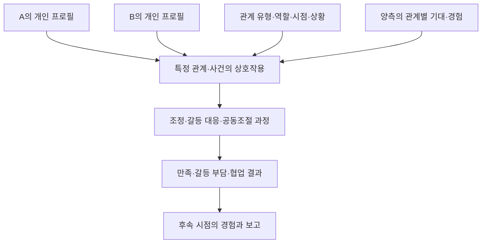

# 관계 모델·6개 팩터 연구 종합 인수인계

작성 기준일: 2026-10-16

대상: 연구 담당자, 심리·통계 검토자, 서비스 기획자, 후속 AI 에이전트

짝 문서: [서비스 종합 인수인계](service-briefing.md)

현재 상태: **이론 통합·측정 설계 가설.** 이 문서는 2026-10-16 이전 기록이다. 같은 날 연구가 재개되었고(D-009) 이후 방향은 [연구 로드맵](../research/research-roadmap.md)을 기준으로 한다.

## 1. 문서 목적, 출처, 확정 수준

이 문서는 관계 분석 서비스를 위한 모델이 어떤 문제의식에서 출발했고, Agency / Communion / Security / Autonomy / Regulation / Coordination이라는 여섯 후보를 왜 제시했으며, 이후 어떤 비판과 보완을 거쳤는지 정리한다. 최종 정의만 전달하면 사라지기 쉬운 개념의 경계, 대안, 측정의 한계와 미정 사항을 함께 기록한다.

출처는 현재 제공된 프로젝트 대화, 사용자가 공유한 여섯 팩터 평가문, 저장소에 정리된 모델·연구안·참고문헌이다. 모든 과거 세션의 원문을 수집한 것은 아니다. 이번 작업은 이 기록을 종합하는 문서화이며, 새로운 체계적 문헌고찰·원문 전수 검토·실험·표본 분석을 수행한 것은 아니다. 아래 문헌은 기존 논의의 이론적 근거와 재검토 경로를 제공하며 본 서비스 모델이 검증되었다는 증거로 사용하지 않는다.

문서에서 **확정**은 사용자 방향·요구, **제안**은 미승인 설계안, **가설**은 검증할 주장, **보류**는 현재 실행하지 않는 주제, **미정**은 선택하지 않은 항목이다. 기존 연구에서 지지되는 개념과 우리 서비스에서 검증해야 하는 새 조합은 별개다.

현재 확인된 것은 다음과 같다.

- 독립 관계심리 모델을 연구하고 MBTI를 보조 입력으로 사용한다는 방향은 유지한다.
- 여섯 명칭은 유망한 연구 영역 후보이지, 병렬적인 여섯 잠재요인으로 검증된 척도가 아니다.
- 실제 자체 문항 세트·채점식·가중치·규준·유형 추정 모형·궁합 예측 모형은 아직 없다.
- 연구 방법은 나중에 재논의하고 서비스 플로우를 먼저 정리하라는 사용자 지시가 유지된다.
- 이 문서의 측정·표본·추적 계획은 보존된 제안이며 모집이나 수집을 시작하라는 실행 승인이 아니다.

## 2. 모델이 풀려는 질문

서비스가 설명하려는 것은 한 사람의 유형 이름뿐 아니라, 개인의 관계 행동과 특정 상대를 만났을 때의 상호작용이다. 여기에는 서로 다른 질문이 들어 있다.

1. 나는 관계에서 요구를 어떻게 표현하고 상대에게 어떻게 반응하는가?
2. 가까운 상대의 거절·의존·갈등을 어떻게 기대하고 경험하는가?
3. 관계에 참여하고 행동하는 이유는 얼마나 자발적인가?
4. 감정이 올라왔을 때 어떤 전략을 쓰고 어떻게 회복하는가?
5. 두 사람은 요구·역할·목표 차이를 실제로 어떻게 조정하는가?
6. 이 정보를 알면 관계 경험이나 대응 행동을 더 잘 예측·개선할 수 있는가?

첫 다섯 질문에 설명할 언어가 있다는 것과 마지막 질문에 실증적으로 답할 수 있다는 것은 다르다. 이 때문에 모델의 이론적 정합성, 문항의 측정 성능, 관계 결과의 예측, 솔루션의 효과를 구분해서 연구해야 한다는 방향으로 논의가 발전했다.

## 3. 논의의 발전 과정

### 3.1 친숙한 유형과 직관적인 도표에서 출발

초기에는 MBTI 입력과 몇 가지 추가 행동 문항을 이용해 개인의 관계 패턴을 쉽게 보여주는 방식이 검토되었다. 여러 축의 도표, 특히 육각형 프로필처럼 한눈에 비교할 수 있는 표현도 관심 대상이었다. 초기 표시용 예시에는 소통 직접성, 정서적 확인, 갈등 직면, 신뢰 안정, 자율성, 목표 조율 같은 이름이 등장했다.

그러나 이런 명칭은 사용자에게 설명하기 쉬운 영역이지 곧바로 독립적인 심리 요인이라고 볼 수 없다. 예를 들어 소통 직접성과 갈등 직면은 겹칠 수 있고, 신뢰 안정에는 개인의 기대와 현재 상대에 대한 평가가 섞일 수 있다. 따라서 “육각형이 필요하니 여섯 점수를 만든다”보다 “이론과 자료가 무엇을 구별하도록 요구하는가”를 먼저 따져야 한다는 문제의식이 생겼다.

초기의 표시 축과 이후의 여섯 영문 후보는 동일한 척도의 단순 번역·개명 관계가 아니다. 화면의 여섯 영역, 여섯 연구 주제, 통계적으로 확인된 여섯 요인은 서로 다른 개념이다.

### 3.2 여러 이론의 교집합에서 후보를 찾기

사용자는 MBTI 유형별 임의 점수나 설명 템플릿보다 관계심리 이론에 근거한 독립 모델을 원했다. 이에 대인관계, 애착, 동기, 정서조절, 상호의존 이론에서 반복적으로 중요한 개념을 찾아 후보를 구성하는 접근이 논의되었다.

20~30개 정도의 관련 개념을 먼저 비교하고, 정의·중복·측정 수준·관계 결과 예측·개입 가능성을 검토해 핵심 영역을 줄이는 Evidence Map 방식이 제안되었다. 이 수치는 실제 검토 완료된 개념 수가 아니라 연구 출발 범위를 가늠하는 예시였다.

### 3.3 여섯 후보 영역 제시

그 과정의 작업 가설이 Agency, Communion, Security, Autonomy, Regulation, Coordination이다. 관계에서 영향력을 행사하고, 온정적으로 연결되고, 안전을 기대하고, 자발적으로 참여하고, 감정을 다루고, 서로 차이를 조정한다는 문제들을 포괄하려는 시도였다.

초기 정의는 넓었다. Autonomy에 독립성과 거리·경계 선호가 함께 들어가거나, Regulation에 계획성과 일반 자기통제가 섞이거나, Coordination이 개인 능력인지 두 사람의 결과인지 불분명해지는 문제가 있었다.

### 3.4 사용자가 공유한 평가문과 구조 수정

사용자가 제공한 평가문은 여섯 후보의 적합도를 동일하게 보지 않았다. Agency·Communion은 강한 출발점으로 유지하되, Security를 불안·회피로 나누고, Autonomy를 SDT의 자율 지향성으로 고정하고, Regulation을 정서·갈등 조절로 좁히며, Coordination을 상호작용층으로 옮기는 방향이었다.

핵심 이유는 이름이 마음에 들지 않아서가 아니라 **분석 수준과 구성개념이 뒤섞여 있기 때문**이다. 이를 바탕으로 개인 프로필과 두 사람의 상호작용을 구별하는 구조가 제안되었다. 다만 서로 다른 종류의 예측변수를 하나의 서비스 모델에 사용하는 것 자체가 잘못은 아니다. 문제가 되는 것은 이들을 같은 수준의 독립 잠재요인으로 이미 확인한 것처럼 제시하는 것이다.

### 3.5 측정·검증·데이터 축적 제안과 보류

후속 질문은 각 팩터를 어떻게 보완·측정하고, 본인·상대 유형 및 관계 분석을 어떻게 연구할 것인가였다. 문항 개발, 간이·심화 검사, 직접·관찰 응답, EFA/CFA, APIM, 후속 결과 측정 등이 제안되었다.

이후 사용자는 연구 방법은 보관하고 서비스 플로우를 먼저 정리하겠다고 했다. 현재는 그 연구안을 잊지 않고 이어받을 수 있도록 기록하는 단계다. 이 문서가 상세하다는 이유로 연구가 재개되었다고 해석하지 않는다.

## 4. 이론적 지도: 무엇을 근거로 삼고 무엇을 등치하지 않는가

아래 표는 기존 논의의 이론 지도다. 일부는 직접적인 측정 후보를 제공하고, 일부는 앞으로 비교할 배경 관점이다. 이론 이름이 표에 있다는 사실만으로 해당 이론을 체계적으로 검토했거나 우리 모델의 독립 요인을 도출했다는 뜻은 아니다.

| 이론·연구 전통 | 이번 논의에서의 역할 | 연결 후보 | 등치하면 안 되는 내용 |
|---|---|---|---|
| Sullivan의 대인관계 관점 | 반복되는 대인 패턴을 이해하는 출발 관점 | 관계 맥락에서 개인 이해 | 특정 여섯 요인의 직접 검증 근거로 사용하지 않음 |
| Leary·Wiggins 계열 Interpersonal Circumplex, IPC | 대인행동의 주도·온정 축 검토 | Agency, Communion | 모든 관계 변인을 두 축으로 설명하거나 언제나 좋은 조합이 정해졌다고 가정하지 않음 |
| Agency·Communion 사회인지 연구 | 자신·타인을 평가하는 넓은 내용 구분 | 영향력·온정 개념 비교 | 넓은 사회평가 개념과 IPC 행동축의 범위를 자동 동일시하지 않음 |
| Warmth·Competence 관점 | 온정·유능함 평가와의 비교 | Communion과 일부 접점 | Competence를 곧 Agency로 바꾸지 않음 |
| Big Five 등 성격 연구 | 일반 성격과 중복·추가 설명력 비교 | 외향성·우호성·성실성 등 | 외향성=Agency, 우호성=Communion이라는 완전한 대응으로 사용하지 않음 |
| Bowlby·Ainsworth, 성인 애착 연구 | 친밀한 관계의 기대·정서·행동 검토 | 불안·회피 | 어린 시절 경험으로 현재 관계를 결정론적으로 설명하지 않음 |
| Deci·Ryan의 Self-Determination Theory, SDT | 행동의 자발성·자기동의에 주목 | Autonomy | 자율성을 독립성이나 친밀감 회피와 혼합하지 않음 |
| Gross의 정서조절 연구 및 관련 척도 | 정서를 다루는 전략·과정·어려움 구별 | Regulation | 특정 전략 사용 빈도를 조절 능력 전체로 취급하지 않음 |
| Kelley·Thibaut·Rusbult·Van Lange 계열 상호의존이론 | 상호 영향·상황 구조·행동 선택 검토 | Coordination의 관계적 해석 | 이론으로부터 하나의 Coordination 척도가 자동 도출되었다고 주장하지 않음 |
| 사람–환경·사람–사람 적합성 | 맥락과 조합의 효과를 검토할 배경 | 관계 유형별 적합성 | 비슷함 또는 다름 자체를 궁합의 정답으로 사용하지 않음 |
| 신뢰·사회인지·관점수용 연구 | 기존 후보의 경계를 점검할 비교 영역 | 신뢰, Responsiveness, Perspective-taking | 신뢰·정확한 이해·온정을 하나로 합치지 않음 |

직접 검토할 원문·척도 자료는 문서 말미와 [기존 참고자료](../research/references.md)에 있다. 위 표의 넓은 배경 이론 중 개별 문헌이 연결되지 않은 영역은 Evidence Map에서 출처와 적용 범위를 보강해야 한다.

## 5. 여섯 후보에 대한 현재 평가 요약

| 초기 영역 | 유지할 가치 | 구조적 문제 | 현재 보완안 | 상태 |
|---|---|---|---|---|
| Agency | 요구 표현·주도·영향력 | 자신감·유능함·강압성과 범위가 섞일 수 있음 | 대인행동의 자기주장·영향력으로 좁혀 측정 | 핵심 후보 유지 |
| Communion | 온정·관심·협력 | 배려 동기와 이해 정확성·반응 역량 혼합 | 온정·협력 성향을 중심으로 하위 내용 구별 | 핵심 후보 유지 |
| Security | 친밀감·의존·거절 기대 | 단일 안정 점수가 다른 불안·회피 패턴을 가림 | 애착불안·애착회피를 별도 측정 | 재구성 후보 |
| Autonomy | 자발성·자기동의 | 독립성·거리 선호·경계 설정과 혼합 | SDT 자율 지향성으로 개념 고정; 특정 관계 동기와 구별 | 정의 보완 후보 |
| Regulation | 정서·갈등 대응과 회복 | 반응성·전략·능력·계획성을 한 점수로 합칠 위험 | 정서·갈등 조절로 제한, 하위 측정면 분리 | 정의·구조 검토 후보 |
| Coordination | 요구·역할·목표 차이의 실제 조정 | 개인 특성·상호작용·결과가 혼재 | 개인층에서 분리하여 dyadic 과정·결과로 검토 | 상호작용층 이동안 |

“적합도가 높다”는 기존 평가의 표현은 개념적 유망성을 뜻한다. 실제 요인적재량, 예측 성능, 효과크기를 계산해 순위를 확정한 결과가 아니다.

## 6. Agency: 관계에서 자신의 의사를 드러내고 영향력을 행사하는 방식

### 6.1 초기 의미와 유지 근거

초기 Agency에는 주도성, 자기주장, 영향력, 자신감, 목표 추구가 포함되었다. 관계에서 자신의 요구를 드러내는지, 의사결정에 참여하는지, 누가 방향을 제안하는지를 설명하려는 영역이다. IPC의 대인행동 축과 연결해 비교할 수 있다는 점이 유지 근거다. 참고자료 [R1]~[R3].

### 6.2 보완할 경계

주도적으로 말하는 것, 실제로 유능한 것, 상대를 강압적으로 통제하는 것은 다르다. 이를 하나의 높은 점수로 묶으면 “높을수록 좋은 리더십”처럼 오해하거나 강압을 긍정적으로 포장할 수 있다. 자기주장의 강도와 온정·존중의 방식은 함께 보되 구별해야 한다.

또한 관계별 역할이 행동을 바꿀 수 있다. 직장에서 지시하는 사람도 친밀한 관계에서는 의견을 미룰 수 있다. 일반 성향과 특정 상대·상황에서의 행동을 별도 기록하는 방향이 적절하다는 제안이다.

### 6.3 측정 후보와 검토 방법

- 자기보고: 요구·의견을 표현하는 경향, 결정 제안, 불일치 상황에서 발언하는 행동.
- 상대보고: 상대가 경험한 주장 방식·의사결정 참여·압박 정도.
- 상황 문항: 원하는 일정이 다를 때, 역할 분담이 불균형할 때 어떤 행동을 하는지.
- 비교 기준: IPC 관련 측정과 수렴하는지, 유능감·외향성·강압과는 무엇이 다른지.
- 관찰 후보: 발언 순서·제안·요청·반응 등을 맥락과 함께 평가. 단순 발언량만으로 Agency를 확정하지 않음.

새 문항의 의미 예시: “상대와 의견이 다를 때 내가 원하는 바를 구체적으로 말한다.” 이 문장은 독자적인 설명 예시이며 검증되거나 채택된 검사 문항이 아니다. 기간·응답 척도·역할 맥락을 정한 뒤 내용 검토가 필요하다.

## 7. Communion: 온정과 관심을 표현하고 협력하려는 성향

### 7.1 초기 의미와 유지 근거

초기 Communion은 온정, 배려, 공감, 연결감, 협력을 포괄했다. Agency와 함께 대인행동을 해석하는 핵심 출발축으로 유지할 수 있다는 평가다. 참고자료 [R1]~[R3].

### 7.2 보완할 경계

상대를 배려하려는 마음, 상대의 감정을 정확히 알아차리는 능력, 실제로 필요한 반응을 제공하는 행동은 같은 것이 아니다. 따뜻한 의도로 행동해도 상대의 필요를 잘못 이해할 수 있다. 따라서 공감 정확성, 관점수용, Responsiveness를 Communion의 동의어로 처리하지 않는다.

Responsiveness나 Perspective-taking을 추가 개인 후보로 검토할 수는 있다. 다만 기존 Communion을 통제한 뒤 관계 결과를 더 설명하는지, 문항 수준에서도 충분히 구별되는지 확인해야 한다. 후보 이름을 늘리는 것만으로 모델의 품질이 높아지지는 않는다.

### 7.3 측정 후보와 검토 방법

- 자기보고: 관심 표현, 협력 선택, 상대의 어려움에 반응하려는 성향.
- 상대보고: 실제로 관심·이해·지원받았다고 경험하는 정도.
- 사건 평가: 위로나 도움을 요청한 상황에서 무엇을 했는지와 상대가 어떻게 경험했는지.
- 비교 기준: IPC 온정 축, 일반 우호성, 관점수용·반응성과의 중복 및 차이.

의미 예시: “상대가 어려움을 말할 때 무엇을 필요로 하는지 확인하려 한다.” 이는 검증 전 문항 예시이며, 온정 동기와 확인 행동을 함께 포함하므로 최종 문항 개발에서는 무엇을 측정할지 더 좁혀야 한다.

높은 Communion을 언제나 좋은 관계의 보장으로 제시하지 않는다. 자신의 요구를 표현하는 방식, 역할 부담, 상대 반응과 함께 해석해야 한다는 설계 방향이다.

## 8. Security: 단일 안정성보다 애착불안과 애착회피

### 8.1 초기 의미와 수정 이유

초기 Security는 관계의 안전감·안정감·신뢰를 설명하려는 넓은 영역이었다. 그러나 하나의 점수로는 “거절당할까 걱정하여 확인을 반복하는 패턴”과 “가까워지거나 의존하는 것을 불편해하는 패턴”을 충분히 구별하기 어렵다는 비판이 제기되었다.

보완안은 애착불안과 애착회피를 각각 측정하는 것이다. 두 차원이 모두 낮은 패턴, 한쪽만 높은 패턴, 둘 다 높은 패턴을 단일 평균으로 압축하지 않는다. ECR-RS 등은 일반적·상대별 애착을 검토하는 비교 후보로 제시되었다. 참고자료 [R4].

### 8.2 구별해야 할 내용

| 구분 | 예시 질문 | 이유 |
|---|---|---|
| 애착불안 | 거절·관심 상실을 얼마나 우려하는가 | 친밀감과 확인 요구의 패턴을 다룸 |
| 애착회피 | 가까워짐·의존·감정 공개를 얼마나 불편해하는가 | 불안과 다른 축의 정보를 보존 |
| 현재 상대에 대한 신뢰 | 이 상대가 약속을 지키는가 | 상대의 실제 행동과 관계 경험에 관한 평가 |
| 현재 관계의 안전감 | 이 관계에서 존중받고 안전하다고 느끼는가 | 개인 성향만으로 설명해서는 안 되는 맥락 |
| 일반 대인 기대 | 여러 관계에 걸쳐 비슷한 기대가 반복되는가 | 특정 상대 반응과 일반 패턴 구별 |

현재 상대의 행동 때문에 생긴 불안이나 불신을 곧바로 사용자의 고정된 결함으로 해석하지 않는다. 발달적 관점은 현재 패턴을 이해하는 배경이지만, 어린 시절 경험이 현재 관계를 완전히 결정한다는 설명으로 사용하지 않는다.

### 8.3 측정 후보와 검토 방법

- 불안·회피 하위 점수를 각각 유지한다.
- 일반 관계와 특정 상대를 묻는 문항의 대상을 명확히 표시한다.
- 현재 사건과 관계 기간·변화 등 해석 맥락을 함께 수집하는 안을 검토한다.
- 자기보고와 상대 관찰이 다르면 하나를 자동 정답으로 정하지 않는다.
- 단기 재검사에서 변화가 나오면 측정오차뿐 아니라 실제 사건·관계 변화도 점검한다.

의미 예시: 불안은 “상대의 반응이 늦으면 관계가 멀어진 것은 아닌지 걱정한다”, 회피는 “힘든 일을 겪어도 이 상대에게 기대는 것이 불편하다”처럼 구분할 수 있다. 둘 다 검증 전 설명 예시이며 기준 기간과 맥락의 영향을 받는다.

“안정형” 같은 설명용 이름을 쓰더라도 연속 점수의 정보를 버리거나 사람을 고정 유형으로 단정하는 정책은 아직 정해지지 않았다.

## 9. Autonomy: 독립성 대신 SDT의 자율 지향성

### 9.1 초기 혼합과 수정 이유

초기 Autonomy에는 자율성, 독립성, 개인 공간, 거리 선호, 경계 설정이 함께 포함되었다. 사용자가 공유한 평가문은 이 혼합을 핵심 수정 사항으로 지적했다. SDT 관점의 자율성은 주로 **스스로 납득한 이유와 가치에 따라 행동하는 자발성·자기동의**를 다루며, 혼자 행동하거나 상대와 거리를 두는 것과 같지 않다. 참고자료 [R5]~[R7].

사람은 자신의 의사로 상대에게 의지할 수 있고, 외부 압박 때문에 혼자 해결하려 할 수도 있다. 따라서 “독립적인 사람은 자율성이 높다” 또는 “자율성이 높으면 친밀감을 덜 원한다”는 자동 해석을 제거해야 한다.

### 9.2 수준별 구별

| 개념 | 무엇을 묻는가 | 모델에서의 후보 위치 |
|---|---|---|
| 일반 자율 지향성 | 행동을 이해·선택할 때 자기동의에 얼마나 지향하는가 | 개인 프로필 후보 |
| 특정 관계의 자율적 동기 | 이 관계에 참여하고 행동하는 이유는 무엇인가 | 관계별 동기 모듈 후보 |
| 자율성 충족 경험 | 이 관계에서 자신의 의사대로 행동할 수 있다고 느끼는가 | 경험·결과 측정 후보 |
| 상대의 자율성 지지 | 상대가 선택과 관점을 존중하는가 | 상호작용·상대 행동 후보 |
| 독립·거리·경계 선호 | 혼자 결정하거나 개인 공간을 얼마나 원하는가 | 필요 시 별도 개념으로 검토 |

일반 지향성과 특정 관계의 동기를 한 검사에서 자동 교환하지 않는다. GCOS의 여러 동기 지향성도 단순히 자율성과 그 반대라는 하나의 양극 점수로 처리하지 않는다. 관계에서 사용하는 문항은 그 수준에 맞는 도구와 검증이 필요하다.

### 9.3 측정 후보와 검토 방법

- GCOS: 일반 동기 지향성 비교 후보.
- SRQ 계열 자료: 특정 활동·관계의 행동 이유를 검토하는 출발 자료.
- 같은 행동을 하더라도 자발적 선택, 인정·비난 회피, 의무감 등 이유를 구별하는 문항안.
- 애착회피·독립성·자기주장과의 판별타당도 검토.

의미 예시: “이 관계에서 중요한 선택을 할 때 내 가치와 이유를 납득하고 행동한다.” 이는 특정 관계에서의 자율적 행동 이유에 가까운 예시이므로 일반 자율 지향성의 검증된 문항으로 대체해서는 안 된다.

## 10. Regulation: 정서·갈등 조절로 범위를 한정

### 10.1 초기 의미와 수정 이유

초기 Regulation은 감정, 스트레스, 충동, 갈등 대응, 회복을 포괄했다. 일부 연결에서는 계획성·구조 선호·일반 자기통제까지 섞일 위험이 있었다. 현재 보완 방향은 Affect & Conflict Regulation, 즉 관계 상황에서의 정서·갈등 조절로 한정하는 것이다.

계획을 좋아하는지와 갈등 중 감정을 다루는지는 다른 질문이다. 따라서 MBTI J/P나 성실성 관련 구조 선호를 정서조절의 직접 대리값으로 사용하지 않는다. 참고자료 [R8]~[R10].

### 10.2 하나로 뭉치지 말아야 할 측정면

| 측정면 | 질문 | 해석 주의 |
|---|---|---|
| 정서반응성 | 감정이 얼마나 빨리·강하게 올라오는가 | 반응이 강한 것과 조절을 못하는 것은 동일하지 않음 |
| 조절 전략 | 재해석·표현 억제·주의 전환 등을 어떻게 사용하는가 | 전략 빈도는 전반적 능력 점수가 아님 |
| 조절의 어려움 | 감정 상황에서 행동·주의·목표 유지가 얼마나 어려운가 | 자기보고된 어려움과 객관적 능력을 구별 |
| 회복 과정 | 갈등 후 언제·어떻게 다시 대화할 수 있는가 | 상대 반응·사건 강도·시간 자료 필요 |
| 갈등 행동 | 중단 요청·비난·경청·대화 복귀 등을 어떻게 하는가 | 개인 행동과 두 사람의 공동 과정을 구분 |

ERQ는 재평가·표현 억제 등 전략을 비교할 후보이고, DERS는 조절의 어려움을 검토할 후보이다. 두 도구 중 하나의 점수를 가져왔다고 정서·갈등 조절 전체를 측정한 것은 아니다. 감정 표현이 적거나 겉으로 조용한 사람을 자동으로 조절 능력이 좋은 사람으로 판단하지 않는다.

### 10.3 측정 후보와 검토 방법

- 전략·어려움·회복 문항을 목적별로 분리해 내용 타당성을 검토한다.
- 갈등 사건 직후와 일정 시간 뒤의 보고를 연결하는 방법을 검토한다.
- 자기보고와 상대가 경험한 행동, 가능할 경우 관찰 자료를 비교한다.
- 재평가·억제 등 특정 전략을 맥락 없이 무조건 좋음·나쁨으로 점수화하지 않는다.
- 개인 조절과 상대가 안정·악화에 기여하는 공동조절을 별도 분석한다.

의미 예시: “갈등 중 감정이 격해지면 대화를 다시 시작할 시점을 정하고 잠시 멈춘다.” 이는 특정 갈등 대응 행동의 예시이며 조절 능력 전체나 모든 상황의 바람직한 행동을 대표하지 않는다.

## 11. Coordination: 개인 팩터에서 두 사람의 조정 과정으로

### 11.1 초기 의미와 핵심 문제

초기 Coordination은 요구·역할·가치·목표의 차이를 맞추는 능력으로 제안되었다. 서비스에서 중요하지만, 누군가의 고정된 개인 점수인지, 두 사람이 실제로 조정하는 과정인지, 그 결과가 좋았다는 평가인지가 혼재했다.

상호의존이론은 두 사람의 선택과 결과가 서로 연결되고 상황 구조의 영향을 받는다는 관점을 제공한다. 그러나 이론 자체가 우리 서비스용 단일 Coordination 요인을 검증해 주는 것은 아니다. 따라서 개인층에서 떼어내 상호작용층의 과정·결과로 검토하자는 방향이 나왔다. 참고자료 [R10]~[R12].

### 11.2 세 수준을 분리

| 수준 | 예시 | 측정 대상 |
|---|---|---|
| 개인의 관련 역량·성향 | 상대 요구를 확인함, 타협안을 제시함 | 개인 자기보고·상대보고·상황 과제 |
| 실제 dyadic 과정 | 요구 확인 → 대안 제시 → 역할 합의 → 재조정 | 같은 사건의 양측 응답·관찰·시간 흐름 |
| 결과 | 합의가 실행됨, 공정하다고 느낌, 부담이 줄어듦 | 합의 이행·각자의 경험·후속 결과 |

개인 협상 역량을 후보로 연구할 수는 있지만 그것을 실제 관계의 Coordination과 같은 것으로 부르지 않는다. “두 사람의 프로필에서 발생한다”는 말도 프로필만 넣으면 결정적으로 계산된다는 뜻으로 사용하면 안 된다. 역할, 권력, 자원, 일정, 사건의 중요도, 관계 이력 등이 개입할 수 있다.

### 11.3 측정 후보와 검토 방법

- 같은 갈등·역할 분담 사건에 대해 양측이 요구·제안·합의·이행을 보고한다.
- 서로의 행동을 어떻게 지각했는지와 자기 행동을 구별해 수집한다.
- 관찰 과제에서는 대안 탐색·요청·응답·수정의 순서를 검토한다.
- Dyadic Coping Inventory 같은 도구는 공동 스트레스 대처를 비교할 후보지만, 가치·목표·역할 조정 전체를 대표하지는 않는다.
- 관계만족을 결과로 사용할 경우 Coordination 문항과 내용이 중복되어 예측력을 과장하지 않는지 검토한다.

의미 예시: “최근 역할을 나눌 때 두 사람 모두 동의한 기준을 정했고, 이후 실제로 지켜졌는가?”는 조정과 이행을 탐색하는 사건 질문이다. 한 문항에 과정·결과가 함께 있으므로 실제 검사지에서는 분리하고 양측에 같은 사건을 묻는 방식이 필요하다.

## 12. 권장 모델 구조와 요인 수의 의미

### 12.1 두 층의 개념 설계

기존 평가문의 핵심 제안은 개인 프로필층과 dyadic 상호작용층을 구분하는 것이다. 이를 더 구체적으로 설명하면 개인의 일반 패턴, 특정 상대에 대한 경험, 실제 상호작용, 관계 결과를 구분해 기록할 필요가 있다.

화살표는 연구할 연결을 보여주는 개념도이며 검증된 인과관계가 아니다. “두 층”은 정보를 구분하는 설계 원칙이지 통계모형이 반드시 2수준이어야 한다는 확정이 아니다. 반복 측정·여러 관계·시간 자료가 추가되면 분석 구조는 달라질 수 있다.

개인층의 우선 검토 목록은 Agency, Communion, 애착불안, 애착회피, Autonomy, 정서·갈등 Regulation이다. 이 목록이 다시 여섯 개라고 해서 새로운 병렬 6요인 모델이 확정된 것은 아니다. Regulation의 하위 구조 등은 더 나뉠 수 있고 일부 변수는 보조 예측변수로 남을 수 있다.

### 12.2 추가 후보를 핵심에 넣는 기준

기존 논의에는 정서반응성, Responsiveness, Perspective-taking, 소통방식 등의 후보가 있었다. 정직–겸손, 계획성, 일반 자기통제 같은 넓은 성격 변인은 우선 보조 예측변수로 검토하는 방향이었다.

검토 기준은 다음과 같이 정리할 수 있다.

- 정의가 분명하고 현재 후보와 구별되는가?
- 관계에서 다루려는 문제에 직접 관련되는가?
- 기존 이론과 측정 자료가 어느 정도 수렴하는가?
- 기존 변수와 맥락을 고려한 뒤 추가 설명력·예측력을 주는가?
- 짧게 측정할 때에도 내용 손실과 오차가 감당 가능한가?
- 개인 효과뿐 아니라 상대 효과·조합효과를 검토할 이유가 있는가?
- 해석·대응 제안에 실제로 도움이 되는가?

상대 효과나 조합효과는 중요한 검토 항목이지만, 모든 개인 변수가 반드시 유의한 partner effect를 보여야만 가치가 있다는 기계적인 채택 기준으로 사용하지 않는다. 기존 척도와 겹친다는 사실 자체도 탈락 사유가 아니다. 독립 모델의 가치는 명칭의 새로움보다 적절한 통합·측정·추가 설명력·사용성에서 평가해야 한다.

## 13. 인지·정서·행동·발달 관점의 위치

초기 논의에서는 관계심리 외에 인지·발달·성격·사회·동기·정서 연구의 교집합을 넓게 살펴보자는 방향이 있었다. 이 접근은 구성개념의 빈틈을 찾는 데 유용하지만 모든 관점을 같은 수준의 팩터로 추가하는 방식은 아니다.

| 관점 | 같은 관계 현상을 보는 질문 | 측정 설계에서의 의미 |
|---|---|---|
| 인지 | 상대의 행동을 어떻게 해석하고 무엇을 기대하는가 | 기대·해석 문항과 실제 행동을 구별 |
| 정서 | 어떤 감정이 얼마나 빨리·강하게 생기는가 | 반응성과 조절을 분리 |
| 행동 | 표현·요청·회피·확인·합의를 어떻게 하는가 | 보고된 의도와 실제 행동 비교 |
| 동기 | 왜 그 행동을 하는가 | 같은 행동의 자발적·통제된 이유 구별 |
| 발달 | 패턴이 어떻게 형성·유지·변화하는가 | 현재 점수를 영구적 본질로 해석하지 않음 |
| 사회·상황 | 역할·문화·관계 조건이 무엇을 가능하게 하는가 | 사람만의 특성으로 맥락을 설명하지 않음 |

예를 들어 “상대가 떠날 것이라는 기대 → 불안 → 반복 확인”은 설명 가설로 유용할 수 있지만, 단면 자기보고만으로 이 시간 순서나 인과관계를 입증한 것은 아니다. 또한 기대·감정·행동 문항이 하나의 요인으로 묶이는지, 관련된 별도 개념인지도 검증 대상이다.

이상적인 자기상과 실제 행동의 차이, 관계·상황에 따른 변동 때문에 행동 중심·최근 경험 문항이 제안되었다. 다만 최근 기간을 물었다고 편향이 사라지는 것은 아니다. 회상 오류·자기표현·현재 기분·사건 선택의 영향을 함께 검토해야 한다.

## 14. MBTI의 역할과 유형 추정의 경계

### 14.1 유지하는 역할

MBTI는 사용자에게 익숙한 진입점, 설명 인터페이스, 자기인식 정보, 탐색적 초기 추정의 입력으로 활용하는 방향이다. 독립 팩터의 이론적 근거나 직접 측정도구로 대체하지 않는다. 참고자료 [R17]~[R18].

| 연결 아이디어 | 허용되는 연구적 해석 | 허용되지 않는 단정 |
|---|---|---|
| E/I와 Agency | 일부 대인행동·일반 성격 내용이 겹칠 수 있어 자료로 확인 | E이면 Agency가 항상 높음 |
| T/F와 Communion | 일부 판단·대인 내용의 관련성을 탐색 | F이면 배려·공감이 높고 T이면 낮음 |
| J/P와 구조 선호 | 계획·정돈 관련 보조 변수로 검토 | J이면 정서조절을 잘함 |
| Security·Autonomy·Regulation | 자체 문항으로 측정해야 할 핵심 영역 | MBTI만으로 애착·자율 동기·조절을 직접 계산 |
| Fe/Fi, Te/Ti 등 기능 매핑 | 별도로 검증할 탐색 가설 | 검증된 심리기제로 점수·궁합 가중치 고정 |

이 표는 가능한 연결을 연구 대상으로 정리한 것이며 상관계수나 매핑의 강도가 확인된 표가 아니다.

### 14.2 입력값과 추정값을 분리

사용자가 입력한 MBTI, 그 출처·시점·확신 정도, 자체 추가검사로 추정한 후보는 별도 보관하는 안이다. “모름”, “여러 결과가 나옴”, “오래전 검사”를 허용하면 정보의 불확실성을 보존할 수 있다.

유형을 입력받아 다시 같은 유형을 출력하고, 입력 유형과 일치하는 비율을 정확도라고 계산하면 순환 검증이 된다. 별도 유형 추정 모델을 만들려면 무엇을 준거로 삼을지, 어떤 선호·차원을 실제 문항으로 측정할지 먼저 정해야 한다. 관계 팩터 문항만으로 MBTI 네 차원 전체를 복원할 수 있다고 가정하지 않는다.

### 14.3 연속 점수와 prior 사용

기존 평가문에서는 이분형 유형 분류의 정보 손실을 줄이기 위해 가능한 경우 연속 정보를 사용하는 방향이 제안되었다. 여기에도 구별이 필요하다. 공식 MBTI 선호 명료도는 성향의 양·능력·일반적인 확률과 같지 않으며, 다른 온라인 검사의 비율과 동일한 척도로 합칠 수 없다.

“초기 prior로 사용한다”는 말은 MBTI에 임의의 가중치 30%를 배정한다는 뜻이 아니다. 연구 자료에서 도움이 되는지 확인하고, 독립 문항이 충분할 때 어떤 추가 가치가 있는지 검토하는 설계 아이디어다. MBTI가 없는 사용자에게도 어떻게 서비스를 제공할지는 함께 설계해야 한다.

## 15. 두 사람의 분석: 유사성·상보성·적합성을 구별

| 용어 | 의미 | 검토할 질문 |
|---|---|---|
| 유사성 | 두 사람이 어떤 특성에서 비슷함 | 비슷함 자체가 결과와 관련되는가, 높고 낮음의 수준 효과인가 |
| 상보성 | 상호작용에서 서로 다른 행동이 맞물림 | 특정 상황의 행동 반응인가, 안정적인 개인 조합 효과인가 |
| 적합성 | 해당 관계·목표·맥락에서 잘 작동함 | 누가 어떤 결과를 기준으로 적합하다고 평가하는가 |
| 맥락 | 역할·관계 종류·사건·시점 등 | 같은 조합이 상황에 따라 달리 작동하는가 |

높은 Agency와 낮은 Agency가 언제나 잘 맞는다는 규칙은 확정하지 않는다. 한 사건에서의 주도–수용 반응과 장기적인 만족은 다른 결과다. 온정의 유사성, 역할의 상보성 같은 아이디어도 관계 유형과 관찰 수준에 맞춰 검증해야 한다.

논의 중 설명 예시로 사용할 수 있는 조합은 다음과 같지만, 모두 **검증 전 가설**이다.

- 높은 자기주장이 갈등 중 충동적 반응과 함께 나타날 때 상대가 압박을 느낄 수 있는가?
- 높은 배려 의도와 높은 애착불안이 함께 있을 때 돌봄과 확인 요구가 어떤 방식으로 구별되는가?
- 같은 행동도 상대의 반응과 관계 상황에 따라 다르게 받아들여지는가?

Autonomy를 거리 선호로 해석하여 “주도성이 높은 사람과 자율성이 높은 사람은 부딪힌다”는 식으로 단순화하면, 수정된 SDT 정의와 맞지 않는다. 과거의 넓은 정의로 만든 조합 예시는 새 정의에 맞춰 재검토해야 한다.

### 15.1 APIM의 역할

Actor–Partner Interdependence Model은 자신의 특성과 자신의 결과 사이의 actor effect, 상대의 특성과 자신의 결과 사이의 partner effect를 구별하고 두 사람 자료의 비독립성을 다루는 분석 틀이다. 참고자료 [R14]~[R15].

APIM을 적용했다고 두 사람의 조합효과가 자동 검증되지는 않는다. 상호작용항이나 그에 맞는 별도 모형이 필요하다. 또한 관찰 자료의 연관성을 인과효과로 바꾸어 주는 도구가 아니다. 관계 유형에 따라 두 구성원을 어떻게 구별할지와 반복 측정 구조도 정해야 한다.

### 15.2 유사성 검증

두 점수의 절대 차이 하나로 궁합을 만들면 각각의 수준 효과와 방향을 잃을 수 있다. 유사성이 연구 질문이라면 다항회귀·반응표면분석 등을 검토하는 안이 제시되었다. 참고자료 [R16]. 이 방법을 사용한다는 사실만으로 모형이 적절해지는 것은 아니므로 결과변수·표본·가설에 맞춰 설계한다.

## 16. 간이·심화 검사 설계의 보완 방향

### 16.1 검사 목적부터 분리

| 모듈 | 목적 | 다른 모듈로 대체할 수 없는 부분 |
|---|---|---|
| 유형·선호 추정 | 입력 MBTI를 보완하는 후보 정보 | 관계 팩터만으로 네 선호 전체를 측정했다고 가정 불가 |
| 개인 관계 프로필 | 일반적인 행동·기대·동기·조절 | 특정 상대가 실제로 경험한 행동과 차이가 날 수 있음 |
| 특정 관계 모듈 | 상대별 기대·맥락·경험 | 일반 성향 점수와 자동 교환 불가 |
| 상대 관찰 모듈 | 사용자가 경험한 상대 행동 | 상대 직접 자기보고와 별개 |
| 양측·사건 모듈 | 같은 관계·사건의 과정과 관점 | 두 개인 프로필만으로 대체 불가 |
| 결과·후속 모듈 | 만족·갈등 부담·행동 실행·변화 | 예측 팩터 문항과 분리 필요 |

간이검사와 심화검사는 상품 가격과 연결될 수 있지만 동일한 개념은 아니다. 검사 길이, 필요한 정보, 결과 설명의 깊이, 구매 단계는 별도로 설계해야 한다.

### 16.2 문항 수 제안의 역사와 해석

기존 논의에는 문항은행 70~100개, 간이 관계 문항 12~18개, 심화 관계 문항 30~40개, 관계 모듈 12~20개 등 여러 규모안이 있었다. 초기에는 더 짧은 전체 구성이나 별도 보정 문항을 상정한 예시도 있었지만, 하나의 확정 검사지로 합의된 기록은 아니다.

이 숫자들을 모두 더해 제품의 검사 길이로 삼거나, 여섯 영역에 같은 수의 문항을 배정해 척도가 완성되었다고 판단하지 않는다. Security를 두 축으로 나누고 Regulation의 하위 측정면을 검토하면 필요한 문항 수도 달라질 수 있다. 유형 추정 문항은 별도의 목적과 분량 검토가 필요하다.

### 16.3 문항 개발 원칙 — 보류안

1. 각 구성개념의 포함·제외 정의와 측정 대상을 먼저 적는다.
2. 행동, 동기, 경험, 전략, 어려움 중 무엇을 묻는지 표시한다.
3. 일반 성향인지 최근 특정 관계인지 기준 기간·상대를 명확히 한다.
4. 한 문항에 여러 행동·가치 판단을 섞지 않도록 검토한다.
5. 자기보고·상대보고의 문항이 누구의 무엇을 평가하는지 맞춘다.
6. 인지면접으로 문항 이해와 응답 이유를 확인하고 수정한다.
7. 짧은 형태는 시간 절감과 함께 내용 손실·측정오차를 평가한다.

“최근 4주” 같은 기간은 행동 빈도 문항의 검토 예시가 될 수 있지만 모든 일반 동기 지향성 문항에 일괄 적용할 기준은 아니다. 동의 정도, 빈도, 상황 선택 중 무엇을 사용할지 내용에 맞게 정한다. “모르겠다·해당 없음”과 중간 점수는 같은 의미로 처리하지 않는다.

심화 문항에 간이 문항이 그대로 포함되어 있으면 두 점수의 상관이 높게 나오는 일부 이유가 문항 중복일 수 있다. 간이형 검증은 심화형과의 단순 상관 하나로 끝내지 않는다. 적응형 검사나 IRT는 문항은행과 보정 자료가 있을 때 검토할 수 있는 후속 방법이며 현재 구현된 방식이 아니다.

## 17. 분리해서 수행해야 할 네 가지 연구

| 연구 과제 | 핵심 질문 | 필요한 근거 | 혼동하면 안 되는 지표 |
|---|---|---|---|
| 유형 추정 | 추가 응답으로 어떤 유형·선호 정보를 추정할 수 있는가 | 준거 정의, 재현성, 별도 평가 자료 | 입력 유형 재출력 비율을 정확도라 부르지 않음 |
| 팩터 측정 | 의도한 개념을 충분히 구별·측정하는가 | 내용·구조·신뢰도·오차·타당도 | 보기 좋은 도표나 높은 내적 일관성만으로 충분하지 않음 |
| 관계 예측 | 맥락과 기존 정보보다 관계 결과를 더 설명·예측하는가 | 양측 자료, actor·partner·조합효과, 후속·외부 검증 | 설명 만족도와 미래 예측을 구별 |
| 솔루션 평가 | 제안이 실제 행동·관계 경험에 도움이 되는가 | 실행 기록, 비교 조건, 시점·탈락 검토 | 공감·결제·클릭을 효과로 대체하지 않음 |

이 네 과제는 서로 관련되지만 하나를 성공했다고 나머지가 검증되는 것은 아니다. 서비스가 재미있고 공감된다는 평가는 사용성과 가치를 평가하는 중요한 자료이나 독립적인 심리·예측 타당도와 구별해야 한다.

## 18. 연구 단계와 표본 제안 — 실행 보류

아래 규모는 기존 논의에 제시된 자원 계획용 예시다. 충분한 표본 수를 보장하는 기준이나 승인된 모집 목표가 아니다. 효과크기, 문항 수, 모형 복잡도, 탈락, 관계 유형, 반복 측정, 검정력 등을 고려해 다시 설계해야 한다.

| 단계 | 목적·작업 | 보존된 규모 예시 | 다음 단계로 넘어가기 전 검토 |
|---|---|---|---|
| 이론·Evidence Map | 약 20~30개 개념의 정의·중복·수준·근거 비교 | 개념 목록 예시 | 후보 포함·보조·제외의 이유 |
| 인지면접 | 질문 이해·대상·응답 과정 점검 | 약 20~30명, 반복 수정 | 오해·중복·부담·해당 없음 |
| 운영 파일럿 | 문항 부담·결측·중단·수집 오류 | 약 80~120명 | 사용성과 수집 체계의 문제 |
| 탐색적 척도 개발 | EFA·문항 내용·기존 척도 비교 | 약 300~500명 | 이론과 구조의 일관성·축소 손실 |
| 독립 확인 | CFA·재검사·간이형·집단 비교 | 별도 약 300~500명 | 새 자료에서의 재현·오차·적용 범위 |
| Dyadic 연구 | 양측 특성·맥락·과정·후속 결과 | 약 250~400쌍을 검토 예시로 제시 | actor·partner·조합효과와 탈락·대표성 |
| 솔루션 효과 | 실행·변화·비교 조건 | 별도 설계 필요 | 제안의 실제 효과와 부작용·부담 |

EFA와 CFA를 같은 자료에서 반복 조정한 뒤 독립 확인처럼 보고하지 않는다. 16유형 조합별 효과를 모두 추정할 수 있는지는 표본 분포와 연구 질문에 달려 있으므로 위 숫자로 16×16 궁합표가 검증될 것이라고 약속할 수 없다.

## 19. 데이터 축적 구조와 출처 관리

### 19.1 기본 단위

개인, 관계, 응답, 문항 버전, 사건, 리포트 노출, 후속 결과를 구별하는 구조가 제안되었다. 실제 DB 스키마가 확정된 것은 아니지만 무엇을 구별해 남겨야 하는지를 정리하면 다음과 같다.

| 데이터 묶음 | 기록 후보 | 필요한 이유 |
|---|---|---|
| 참여·동의 | 가명 ID, 동의 범위·버전, 철회 상태 | 이용과 연구 참여의 범위를 확인 |
| 개인·관계 연결 | 관계 ID, 양측 가명 ID, 관계 종류·시점 | 동일인·동일 관계의 반복 응답 구별 |
| MBTI 입력 | 유형, 출처, 검사 시점, 확신 정도, 모름 | 자기인식 정보의 신뢰 수준·변동 추적 |
| 원응답 | 문항 ID·버전, 답, 응답자, 평가 대상, 기준 기간, 시각 | 재채점·측정 수준·출처 구별 |
| 상황·사건 | 어떤 갈등·조정 사건인지, 역할·맥락 | 동일 사건의 양측 관점 연결 |
| 채점·모델 | 채점식·모델 버전, 하위 점수, 불확실성 | 결과 재현과 버전 비교 |
| 결과 노출 | 어떤 리포트·솔루션을 언제 보았는지 | 후속 응답에 대한 노출 영향 검토 |
| 관계 결과 | 만족·갈등 부담·협업 경험 등 | 예측변수와 별도로 타당도 평가 |
| 행동·후속 | 제안 실행, 변화, 후속 응답 시점 | 사용과 효과를 구별 |
| 서비스 이용 | 검사 중단·완료·초대·결제·열람 상태 | 선택 편향·이탈·운영 개선 검토 |

이 구조는 실제 참여자 자료를 공개 저장소에 저장하라는 뜻이 아니다. 저장소에는 설계·코드·공유 가능한 요약만 두고, 연락처·결제정보·원응답은 별도 접근·보관 체계가 필요하다. 동의·삭제·공유·연구 참여 정책은 후속 설계 대상이다.

### 19.2 인식 차이의 올바른 비교 단위

“A의 자기보고”와 “B의 자기보고”의 차이는 두 사람의 특성 차이일 수 있다. 이를 곧바로 인식 차이라고 부르면 안 된다.

인식 차이를 연구하려면 예를 들어 “A가 평가한 A의 행동”과 “B가 평가한 A의 행동”을 같은 내용·관계·기간 또는 사건에 맞춰 비교해야 한다. B에 대해서도 반대 방향의 대응 자료가 필요하다. 차이가 있다고 어느 한쪽이 거짓말하거나 틀렸다고 단정하지 않는다.

### 19.3 수집 시점과 선택 편향

관계 결과의 기준 상태는 가능하면 리포트 노출 전에 받는 안이다. 결과를 본 뒤 자신의 관계를 다르게 해석할 수 있기 때문이다. 이후에는 노출된 리포트와 솔루션의 버전을 함께 남긴다.

유료 구매자, 상대를 초대한 사람, 실제로 양측 응답을 완료한 커플, 후속 조사에 남은 사람은 서로 다를 수 있다. 결제·초대·완료 여부에 따른 선택 편향과 탈락을 검토하고, 유료 이용자 결과를 모든 사용자에게 자동 일반화하지 않는다.

## 20. 분석·검증 계획에서 구별할 항목

### 20.1 측정 검증

- 내용 타당도: 정의한 영역을 충분히 포함하고 다른 개념을 섞지 않았는가?
- 구조: EFA/CFA 등으로 하위 구조와 문항 연결이 재현되는가?
- 신뢰도·오차: 내적 일관성, 재검사, 측정 정밀도는 목적에 충분한가?
- 수렴·판별타당도: 관련 척도와 연결되면서 필요한 차이는 남는가?
- 측정동일성·적용 범위: 성별·연령·관계 종류·문화·응답 방식에 따라 같은 의미로 작동하는가?
- 간이형: 짧아진 만큼 무엇을 잃고 어떤 용도까지 사용할 수 있는가?

신뢰도 계수 하나가 높다고 구성개념이 옳거나 예측이 정확해지는 것은 아니다. 요인 가중치, 합산 규칙, 예측 가중치도 서로 다른 목적의 값이므로 혼합하지 않는다.

### 20.2 증분 예측력 비교안

아래는 비교 모형을 구분하기 위한 예시이며 확정된 분석계획이 아니다.

| 비교안 | 입력 정보 | 질문 |
|---|---|---|
| M0 | 관계·상황 등 기본 맥락 | 맥락만으로 설명되는 부분은 얼마인가 |
| M1 | 기본 맥락 + MBTI 정보 | MBTI 정보가 추가로 도움이 되는가 |
| M2 | 기본 맥락 + 독립 팩터 | 독립 측정이 제공하는 가치는 무엇인가 |
| M3 | 기본 맥락 + MBTI + 독립 팩터 | 둘을 함께 쓸 추가 가치가 있는가 |
| M4 | 양측 자료 + 사전 지정한 조합·과정 | 상대·조합·실제 과정이 더 설명하는가 |

비교 대상은 같은 결과변수와 적절히 맞춘 평가 자료를 사용해야 한다. 동시점 설명과 미래 예측을 구별하고, 더 복잡한 모형의 개발 자료 성능만으로 개선을 판단하지 않는다.

### 20.3 평가 자료 분리

같은 사람의 반복 응답이나 동일 관계의 두 구성원이 개발·평가 자료에 나뉘어 들어가면 성능이 과장될 수 있다. 사람·관계 단위의 분리를 고려하고, 한 사람이 여러 관계에 참여한 경우 연결된 집단의 누출도 검토한다. 시간·새 모집 집단에서 재현되는지도 후속 평가 대상이다.

규모가 작은 상태에서 정밀한 유형별 확률, 백분위, 궁합 퍼센트를 제시하지 않는다. 0~100으로 환산한 점수는 백분위나 성공 확률과 같지 않다. 규준·확률 보정·오차 설명은 해당 자료와 목적이 갖춰진 뒤 정해야 한다.

## 21. 후속 측정과 솔루션 효과 — 보존된 제안

| 시점 예시 | 목적 | 해석 주의 |
|---|---|---|
| 결과 노출 전 | 최초 관계 상태와 입력 측정 | 보고서를 읽기 전 기준 확보 |
| 일부 표본 2~4주 | 재검사·변화 검토 | 실제 사건 변화와 측정오차 구분 |
| 약 7일 | 제안을 실행했는지 확인 | 실행이 곧 효과는 아님 |
| 약 30일 | 관계 경험·갈등 부담 변화 | 자연 변화·다른 사건·탈락 고려 |
| 일부 약 90일 | 변화의 지속성 검토 | 장기 참여자 선택 편향 고려 |

이 일정은 연구안의 예시이며 예약 발송이나 자동화 요청이 아니다. 실제 연락 수단·참여 동의·응답 부담·비교 조건·표본 규모를 정해야 한다.

솔루션의 효과는 “리포트를 좋아했다”, “결제했다”, “정확하다고 느꼈다”와 분리한다. 대응 제안을 실행했는지, 어떤 상황에서 도움이 되었는지, 비교 조건에 비해 어떤 변화가 있었는지 봐야 한다. A/B 또는 다른 비교 설계를 사용할지는 후속 연구 설계에서 결정한다.

자료가 모이면 자동으로 모델을 학습·교체한다는 운영 방침도 확정되지 않았다. 채점·모델·리포트 버전을 구분하고, 변경 전후 검토와 재현·복구 방법을 정하는 것이 후속 과제다.

## 22. 척도·문화·운영 측면의 남은 검토

기존 척도는 구성개념을 비교하고 문항 설계의 범위를 이해하는 출발점이다. 원문을 번역하거나 일부 문항을 줄여 쓴 것만으로 동일한 타당도를 확보했다고 표현하지 않는다. 상업적 사용 범위, 번역판 근거, 수정·단축의 영향, 대상 관계·문화에 대한 적용을 각각 확인해야 한다.

이 문서에는 원척도 전체 문항을 복제하지 않았다. 팩터별 문항은 독자적인 의미 예시이며 실제 채택·번역·검증 문항이 아니다. 특정 척도 사용을 확정하거나 사용 허가를 취득한 기록도 아니다. 자료 [R19]~[R20]은 후속 확인 경로다.

한국 사용자에게 적용하려면 언어의 자연스러움뿐 아니라 관계 역할·표현 규범·문항 의미의 차이를 검토해야 한다. 현재 한국어 규준이나 모든 관계 유형에 대한 측정동일성이 확보된 상태는 아니다.

연구를 재개할 때에는 연구 책임·검토 체계, 대상·제외 기준, 참여·연결·공유 동의, 보관·삭제, 구체 분석계획, 실패·중단 기준, 통계 검토 체계를 정해야 한다. 이는 현재 실행 중인 절차가 아니라 미정 과제 목록이다.

## 23. 근거 자료와 주장 범위

아래 링크는 기존 논의에서 보관한 자료다. 이번 문서 작성에서 모두 원문 재검토하거나 최신 연구를 전수 검색하지 않았다. 한 연구의 결과를 다른 문화·관계·상품으로 확장하려면 추가 검토가 필요하다. 자료의 존재와 우리 모델의 검증을 구분한다.

| ID | 자료 | 이번 논의에서 참고한 범위 |
|---|---|---|
| R1 | [IPIP-IPC 채점 자료](https://ipip.ori.org/newIPIP-IPCScoringKey.htm) | Agency·Communion과 대인원형 구조 비교 |
| R2 | [Locke, Interpersonal Circumplex Models and Measures of Personality](https://kennethlocke.org/publications/2023_Interpersonal_Circumplex_Models_Measures_of_Personality.pdf) | 행동·동기 등 측정면의 구분 |
| R3 | [Hopwood et al., CAID 연구](https://pubmed.ncbi.nlm.nih.gov/30221975/) | 실제 dyad 행동과 관찰 방법 검토 |
| R4 | [Fraley, ECR-RS 개발자 자료](https://labs.psychology.illinois.edu/~rcfraley/measures/relstructures.htm) | 상대별 불안·회피 측정의 비교 후보 |
| R5 | [SDT, General Causality Orientations Scale](https://selfdeterminationtheory.org/general-causality-orientations-scale/) | 일반 동기 지향성 |
| R6 | [SDT, Self-Regulation Questionnaires](https://selfdeterminationtheory.org/self-regulation-questionnaires/) | 특정 행동·관계의 동기 측정 검토 |
| R7 | [Chirkov et al., 2003](https://pubmed.ncbi.nlm.nih.gov/12518973/) | 자율성과 독립성·개인주의 구별 |
| R8 | [Gross & John, 2003](https://pubmed.ncbi.nlm.nih.gov/12916575/) | 재평가·표현 억제 전략 |
| R9 | [Gratz & Roemer, 2004](https://doi.org/10.1023/B:JOBA.0000007455.08539.94) | 정서조절 어려움의 개념·측정 |
| R10 | [Butler & Randall, 2013](https://doi.org/10.1177/1754073912451630) | 관계에서의 정서 공동조절 |
| R11 | [Rusbult & Van Lange, 2003](https://doi.org/10.1146/annurev.psych.54.101601.145059) | 상호의존과 관계·상황 과정 |
| R12 | [DCI 중국 커플 검증 연구](https://pubmed.ncbi.nlm.nih.gov/27183045/) | 자신·상대·공동 대처의 구별; 모든 맥락에 대한 검증은 아님 |
| R13 | [Funk & Rogge, 2007, CSI](https://pubmed.ncbi.nlm.nih.gov/18179329/) | 관계만족을 별도 결과로 측정할 후보 |
| R14 | [Kenny, Dyadic Analysis](https://davidakenny.net/dyad.htm) | actor·partner 효과와 dyadic 분석 |
| R15 | [Pair Laboratory 연구 자료](https://labs.utdallas.edu/pairlab/research-materials/) | APIM 검정력 검토 자료 |
| R16 | [Schönbrodt et al., 2018](https://doi.org/10.1002/per.2169) | Dyadic response surface analysis |
| R17 | [McCrae & Costa, 1989](https://pubmed.ncbi.nlm.nih.gov/2709300/) | MBTI와 일반 성격 차원의 관계·한계 |
| R18 | [Myers & Briggs Foundation, 결과 안내](https://myersbriggs.org/my-mbti-personality-type/my-mbti-results/home.htm) | 선호 명료도와 성향 강도의 구별 |
| R19 | [IPIP 공식 안내](https://www.ipip.ori.org/) | 도구·문항 사용 조건 확인 경로 |
| R20 | [Stanford Psychophysiology Laboratory 자료](https://spl.stanford.edu/resources) | 정서조절 도구·사용 범위 확인 경로 |

향후 Evidence Map에는 문헌 ID, 정의, 측정 수준, 대상·문화, 도구, 결과변수, 설계, 효과·불확실성, 재현 여부, 한계, 핵심·보조·제외 판단과 이유를 넣는 안이 제시되었다. 아직 이 형식으로 원문을 추출·평가한 완성 데이터베이스는 없다.

## 24. 후속 연구자가 먼저 확인할 질문

1. 여섯 영역을 서비스의 표시 범주로 유지할 것인가, 측정 구조와 별도로 표현할 것인가?
2. Agency·Communion은 일반 행동, 특정 관계 행동, 동기 중 무엇을 우선 측정할 것인가?
3. 애착의 일반·상대별 수준을 어떤 범위에서 수집할 것인가?
4. Autonomy는 일반 자율 지향성과 관계별 동기를 어떤 모듈로 구별할 것인가?
5. Regulation의 반응성·전략·어려움·회복을 어떻게 나누고 어떤 수준의 결과를 제공할 것인가?
6. Coordination의 개인 역량·과정·결과 중 어떤 자료부터 확보할 것인가?
7. 추가 후보가 기존 후보를 넘어 제공하는 가치와 측정 부담은 무엇인가?
8. MBTI 유형 추정 자체를 제품 범위에 넣을지, 넣는다면 준거와 별도 문항은 무엇인가?
9. 간이·심화·상대 관찰·직접 응답을 어떻게 검증하고 구분해 표현할 것인가?
10. 어떤 관계 결과를 먼저 예측하며, 어떤 자료로 외부·후속 검증할 것인가?
11. 솔루션의 효과를 어떤 비교 조건과 시점으로 평가할 것인가?
12. 책임·동의·사용 권한·모집·데이터 관리 체계를 누가 결정할 것인가?

이 질문에 대한 답은 아직 확정하지 않았다. 사용자 재개 요청이 있으면 이 기록을 출발점으로 논의하고, 실행 범위와 판단 근거를 [결정 기록](../decisions/decision-log.md)에 남긴다.

## 25. 핵심 용어와 인수인계 주의사항

| 용어 | 이 프로젝트에서의 의미 |
|---|---|
| 연구 영역 후보 | 설명할 가치가 있어 검토하는 주제; 검증된 독립 요인과 다름 |
| 구성개념 | 무엇을 측정하려는지 정의한 이론적 개념 |
| 잠재요인 | 문항의 공변동 등을 설명하는 측정모형상의 변수 |
| Dyad | 서로 연결된 두 사람의 자료 단위 |
| Actor effect | 개인 특성과 그 개인의 결과 사이의 모형상 효과 |
| Partner effect | 상대 특성과 개인의 결과 사이의 모형상 효과 |
| 증분 예측력 | 기존 정보에 변수를 더했을 때 추가되는 예측 가치 |
| 판별타당도 | 구별하려는 개념이 측정에서도 충분히 구별되는지 |
| 측정동일성 | 집단·조건 간 점수를 비교할 때 의미가 유지되는지 |
| Prior | 추가 자료를 보기 전의 정보·가정; 임의의 확정 가중치가 아님 |
| 인식 차이 | 같은 대상·내용·시점에 대한 서로 다른 관점의 차이 |

후속 담당자가 특히 피해야 할 오류는 “여섯 후보가 검증되었다”, “MBTI로 애착·정서조절 점수를 계산할 수 있다”, “상대 관찰이 상대의 직접 검사다”, “두 프로필만으로 실제 조정 과정을 측정했다”, “사용자가 공감했으니 예측과 솔루션 효과가 입증되었다”는 식의 상태 변경이다.

현재의 성과는 이론과 제품의 연결에서 무엇을 구별하고 무엇을 검증해야 하는지 정리했다는 데 있다. 실제 구조·점수·가중치·효과는 연구 재개 후 자료로 확인해야 하며, 서비스의 확정 흐름과 가격은 [서비스 인수인계](service-briefing.md)를 기준으로 한다.
