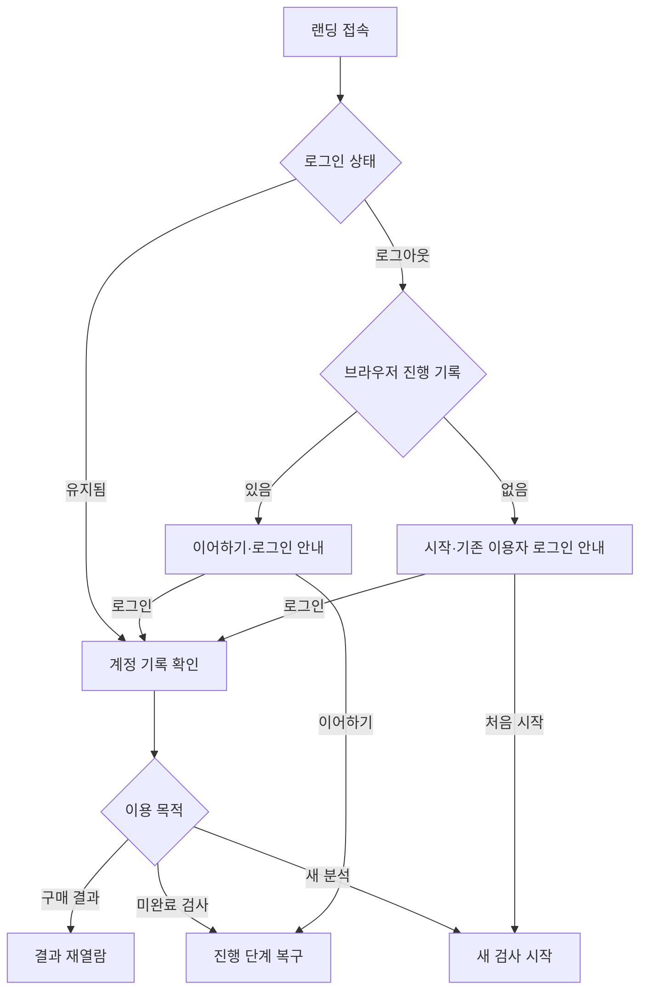
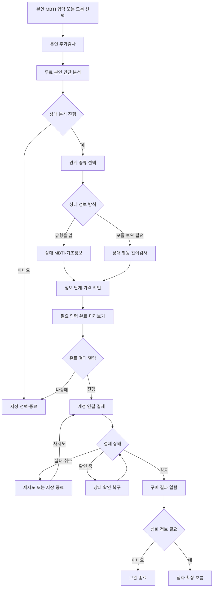
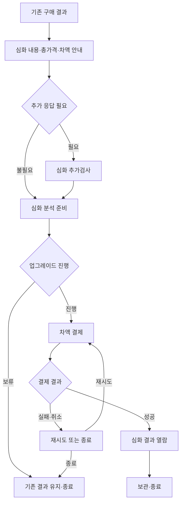

# MBTI 프로젝트 서비스 종합 인수인계

작성 기준일: 2026-10-16

대상: 새 프로젝트 멤버, 기획자, 디자이너, 개발자, 후속 AI 에이전트

짝 문서: [관계 모델·6개 팩터 연구 종합 인수인계](research-briefing.md)

## 1. 이 문서를 읽는 방법과 기록의 범위

이 문서는 현재까지 제공된 프로젝트 대화와 저장소의 기획·결정·연구 문서를 바탕으로, 서비스가 어떤 문제의식에서 출발했고 어떤 논의를 거쳐 현재 흐름에 도달했는지 설명한다. 최종 화면 목록만 전달하는 요구사항 문서가 아니라, 이후 담당자가 기존 판단을 이해하고 다음 결정을 내릴 수 있게 하는 인수인계 문서다.

모든 과거 세션의 원문을 수집한 완전한 대화 아카이브는 아니다. 날짜를 확인할 수 없는 논의에는 임의의 날짜를 부여하지 않았으며, 초기 아이디어와 현재 요구가 다른 경우 현재 요구를 우선한다. 논의 과정에서 제시된 예시를 실제 구현 또는 검증 결과로 읽지 않아야 한다.

| 표기 | 의미 | 후속 작업에서의 처리 |
|---|---|---|
| 확정 | 사용자가 명시한 방향·요구 | 변경하려면 새 결정과 이유를 기록 |
| 제안 | 논의에 나온 구체안이지만 최종 선택은 확인되지 않음 | 검토 대상으로 사용; 이미 합의했다고 가정하지 않음 |
| 가설 | 이론·측정·데이터로 확인해야 하는 설명 | 실제 정확도나 효과처럼 홍보하지 않음 |
| 보류 | 기록은 유지하되 현재 실행하지 않는 주제 | 재개 요청 전에는 실행 과제로 전환하지 않음 |
| 미정 | 아직 선택·설계하지 않은 항목 | 구현 편의를 이유로 제품 결정으로 확정하지 않음 |

최신 상태의 기준은 [현재 상태](../project-status.md)와 [결정 기록](../decisions/decision-log.md)이다. 이 문서는 2026-10-16 시점의 설명형 기록이며, 이후 결정이 생기면 함께 갱신한다.

## 2. 서비스의 출발점: MBTI에서 관계 행동으로

프로젝트는 사용자가 친숙한 MBTI를 입력하고 추가검사를 거쳐, 자신과 상대방의 관계를 이해하도록 돕는 서비스 구상에서 출발했다. 초기 논의에는 본인 유형, 추가 행동 문항, 필요한 배경정보를 받아 연애·친구·직장·배우자 관계의 해석과 대응 방법을 제공하는 방향이 포함되어 있었다.

차별화의 핵심은 유형에 대한 일반적인 성격 설명을 반복하는 데 있지 않다. 사용자가 실제로 궁금해하는 것은 “나는 어떤 유형인가”에 이어지는 “왜 이 상대와 이런 일이 반복되는가”, “같은 말을 왜 다르게 받아들이는가”, “다음 대화에서는 어떻게 행동하면 좋은가”다. 따라서 결과는 유형 소개를 넘어 관계 상황, 행동의 해석 가능성, 실행 가능한 대응으로 이어지는 것을 지향한다.

예를 들어 갈등을 빨리 끝내려는 사람에게는 해결 제안이 관심의 표현일 수 있지만, 상대에게는 자신의 감정을 충분히 듣지 않는 행동으로 경험될 수 있다. 서비스가 다루려는 내용은 이런 차이를 설명하고 확인 질문·대화 순서·요청 방식 등을 제안하는 것이다. 이 사례는 제공 가치의 예시이며, 특정 유형 조합의 검증된 법칙은 아니다.

이 과정에서 모델의 중심을 MBTI 자체에 두면 한계가 생긴다는 문제의식이 명확해졌다. 애착, 정서조절, 자율적 동기, 실제 갈등 조정 같은 관계 변인을 MBTI 네 글자로 직접 측정할 수 있다고 가정하지 않기로 했다. **독립적인 관계심리 모델을 연구하고 MBTI는 사용자 진입과 설명을 돕는 보조 정보로 활용한다**는 방향이 현재의 기준이다.

## 3. 논의가 진행된 흐름과 방향이 바뀐 이유

아래는 주제별 발전 순서다. 각 단계의 모든 아이디어가 최종 요구사항이 된 것은 아니다.

| 논의 단계 | 당시의 관심·아이디어 | 발견된 문제 | 현재 정리 |
|---|---|---|---|
| MBTI 기반 관계 서비스 | 익숙한 유형 입력과 간단한 추가 질문으로 관계 해석 | 일반적인 유형 설명만으로는 개인·관계 차이를 충분히 설명하기 어려움 | MBTI를 보조 입력으로 두고 독립 모델 검토 |
| 시각적인 개인 프로필 | 여러 축의 도표로 관계 성향을 직관적으로 제시 | 화면에 필요한 축 수를 먼저 정하면 이론을 시각화에 맞출 위험 | 표시 영역과 실제 측정 요인을 구별 |
| 6개 후보 영역 | Agency, Communion, Security, Autonomy, Regulation, Coordination | 성향·동기·관계 기대·조절·두 사람의 과정이 같은 층에 혼재 | 정의와 분석 수준을 재검토; 상세 내용은 연구 문서 |
| 본인·상대 입력 확장 | 자기검사, 상대 유형, 관찰 문항, 상대 초대 | 상대에 대한 추정과 직접 응답을 같은 정보로 취급할 위험 | 입력 출처에 따라 표현과 해석 범위를 구분 |
| 전체 서비스 흐름 | 랜딩부터 종료까지 신규·재방문 분기 포함 | 재방문 판별 근거와 로그인·기록 복구가 불명확 | 로그인 상태·브라우저 기록·기존 계정 복구를 구별하는 안 |
| 결제 흐름 수정 | 사용자 검사 이후 상대 분석, 유료 정보 제공 | 결제 단계가 빠져 있었고 유료 결과 공개 시점이 모호 | 본인 간단 분석 → 상대 입력·검사 → 결제 → 유료 결과 |
| 단계형 구매 | 정보의 깊이에 따라 구매하고 나중에 심화 | 처음부터 전체 비용을 요구하거나 업그레이드 때 중복 청구할 가능성 | 4,900~9,900원 범위, 이전 결제 비용을 차감 |
| 논의 우선순위 조정 | 서비스 설계와 연구 설계를 함께 논의 | 두 과제가 섞여 실행 범위가 넓어짐 | 연구 방법은 보류하고 서비스 플로우 우선 |
| GitHub 관리 | 기획·결정·연구와 향후 개발을 연결 | 대화만으로는 상태·근거·수정 이력을 공유하기 어려움 | 문서와 코드를 저장소에서 버전 관리 |

2026-10-07로 기존 결정 기록에 보존된 사용자의 수정 요청이 현재 서비스 흐름의 직접적인 근거다. 핵심은 다음 세 문장에 있다.

> “유저 검사 이후 간단 분석 결과를 제공하고”
>
> “결과 열람 전에 결제를 유도하는거야”
>
> “앞서 결제한 비용을 제외한 금액의 추가 결제”

이때 사용자는 정보 단계별 가격 범위를 4,900원부터 9,900원까지로 제시했고, 연구 방법은 나중에 다시 논의하겠다고 명시했다. 따라서 후속 담당자는 과거의 포괄적인 흐름이나 AI가 제안했던 가격·로그인안을 이 요구보다 우선해서는 안 된다.

## 4. 제공 가치, 대상, 초기 범위

### 4.1 초기 방향

- 한국 사용자를 대상으로 한 웹 서비스 중심의 기획이다.
- 본인 관계 패턴과 특정 상대와의 상호작용을 설명한다.
- 결과는 자기이해, 상대 이해, 반복되는 갈등의 가설, 구체적인 대응 제안으로 이어지는 방향이다.
- 연애·배우자·친구·직장동료 및 역할 관계가 검토 범위에 포함되어 있다.

관계 종류마다 같은 문항과 설명이 동일하게 작동한다고 확인된 것은 아니다. 예를 들어 연인 사이의 친밀감 요구와 직장동료 사이의 역할 조율은 서로 다른 맥락이다. 서비스가 다루려는 범위와 실제로 검증해 적용할 수 있는 범위를 구별해야 한다.

### 4.2 확장 아이디어

웹 결과 열람을 기본으로 하고 이메일·카카오톡으로 열람 링크를 전달하는 기능, 상대를 초대해 직접 응답을 받는 기능, 향후 앱이나 다른 성격·관계 검사 체계를 통합하는 아이디어가 있었다. 모두 확장 후보이며, 이번 기획 기록만으로 발송 기능·모바일 앱·다른 검사 통합이 개발 범위로 확정된 것은 아니다.

결과는 관계를 이해하기 위한 해석과 제안을 지향한다. 임상 진단, 상대의 내면에 대한 확정 판단, 관계의 성공·실패를 보장하는 예측으로 설계된 상태는 아니다.

## 5. 입력과 결과에서 반드시 구별할 정보

### 5.1 본인 유형, 본인 관계 프로필, 두 사람의 분석

| 구분 | 다루는 질문 | 입력·검증의 경계 |
|---|---|---|
| 입력 MBTI | 사용자는 자신의 유형을 어떻게 알고 있는가 | 자기인식 또는 외부 검사 정보; 자체 검사 정답으로 간주하지 않음 |
| 자체 유형 후보 | 추가 응답은 어떤 유형·선호 후보와 연결되는가 | 유형 추정에 맞는 별도 문항·검증 필요 |
| 본인 관계 프로필 | 관계에서 어떤 행동·기대·동기·조절 패턴을 보고하는가 | 독립 관계 문항으로 측정하는 방향 |
| 상대 정보 | 사용자가 상대에 대해 무엇을 알고 경험했는가 | 입력 유형·관찰·상대 직접 응답을 구분 |
| 두 사람의 관계 해석 | 두 프로필과 실제 관계 맥락에서 어떤 과정이 예상·관찰되는가 | 개인 점수만으로 실제 상호작용을 측정했다고 주장하지 않음 |

유형 후보를 복수로 보여주거나 확신 정도를 표시하는 방식은 검토할 수 있지만, 항상 후보 세 개를 내거나 정밀한 확률을 표시하는 정책은 확정되지 않았다. 특히 실제로 보정하지 않은 수치를 “이 유형일 확률”로 노출하지 않는다.

### 5.2 상대 입력의 출처

| 경로 | 실제로 확보한 정보 | 결과에서 가능한 표현 예시 | 피해야 할 해석 |
|---|---|---|---|
| 사용자가 상대 MBTI 입력 | 사용자가 알고 있는 유형 | “입력하신 유형을 전제로 살펴보면…” | 상대의 애착·조절 능력을 직접 검사한 것처럼 표현 |
| 사용자가 상대 행동 문항 응답 | 사용자가 경험한 상대의 행동 | “당신이 경험한 상대의 반응에서는…” | 객관적인 상대 성격 진단으로 단정 |
| 상대가 직접 응답 | 상대의 자기보고 | “상대가 직접 보고한 패턴은…” | 자기보고를 관찰된 사실과 동일시 |
| 양측이 같은 사건·관계를 평가 | 사건에 대한 두 관점 | “같은 상황을 두 사람은 이렇게 다르게 경험했습니다” | 자료가 다른 대상·시점을 다루는데 인식 차이라고 계산 |

상대 초대는 정보의 질을 보완하고 두 사람의 관점을 연결할 수 있는 후보 기능이다. 다만 초대 참여, 검사 응답, 원응답 공개, 요약 결과 공개는 서로 다른 동의·공유 선택이다. 구체적인 범위는 미정이며 상대가 응답했다고 모든 정보를 사용자에게 자동 공개하는 것으로 설계하지 않는다.

### 5.3 배경정보

초기 구상에서는 연령, 성별, 직업, 혼인 여부 등 배경정보가 검토되었다. 현재는 필요한 최소 배경정보를 받는 방향이며, 위 항목 모두가 필수 입력으로 확정된 것은 아니다. 관계 종류·기간·역할 등도 해석 목적에 필요한지 먼저 판단해야 한다.

## 6. 현재 서비스의 확정된 기본 순서

**본인 검사 → 무료 간단 분석 → 상대 정보 입력 또는 상대 관련 간이검사 → 분석 준비 → 결과 열람 전 결제 → 유료 결과 → 필요 시 차액 결제로 심화 확장.**

여기서 “간단 분석”은 기존 서비스 문서에서 무료 본인 요약으로 정리되어 있다. 무료 본인 분석과 결제 전 상대 분석 미리보기는 서로 다른 화면·역할이다. 무료 화면의 세부 내용, 유료 미리보기의 길이, 상품별 상세 항목은 아직 정하지 않았다.

### 6.1 랜딩에서 신규·재방문을 구별하는 방식 — 제안

사용자의 질문은 “재방문인지 어떻게 알고, 기존 접속을 어떻게 확인할 것인가”였다. 이를 해결하려면 실제 계정 기록과 현재 브라우저의 진행 흔적을 구별해야 한다. 단순히 쿠키나 임시 기록이 없다는 이유로 처음 이용하는 사람이라고 단정할 수 없다.

이 흐름의 목적은 방문 이력을 완벽하게 추론하는 것이 아니라, 사용자가 현재 확보된 기록에 맞게 시작하거나 복구할 수 있도록 하는 데 있다. 비로그인 방문자에게는 언제든 “기존 결과가 있다면 로그인” 경로가 필요하다.

| 상태 | 제안 동작 | 아직 정할 내용 |
|---|---|---|
| 로그인 유지 | 계정의 결과·진행 중 검사 표시 | 세션 유지·재인증 정책 |
| 비로그인·브라우저 기록 있음 | 이어하기와 로그인 모두 제공 | 임시 저장 방식·만료·공용 기기 처리 |
| 비로그인·브라우저 기록 없음 | 검사 시작과 기존 계정 로그인 제공 | 다른 기기 복구 경로 |
| 검사 후 로그인 | 비회원 진행을 계정에 연결 | 계정에 기존 기록이 있을 때 병합·선택 규칙 |
| 로그인했지만 구매 기록을 못 찾음 | 계정·결제 기록 확인 경로 | 계정 중복·고객지원·복구 정책 |

**비회원으로 본인 검사를 시작하고 결제 직전에 로그인하는 방식은 제안**이다. 진입 부담과 구매 기록 복구 필요를 함께 고려한 안이며, 이메일 인증·간편로그인 제공자·최초 로그인 시점이 최종 결정된 것은 아니다.

### 6.2 본인 검사부터 최초 구매까지

도표의 계정 연결 시점, 저장 기능, 재시도 화면은 구현 제안이다. 사용자가 확정한 것은 검사·입력 이후 유료 결과 열람 전에 결제가 위치한다는 점이다.

“결과가 준비됨”과 “결제 전 상세 결과가 공개됨”은 다르다. 전자는 필요한 정보가 모였고 제공 가능한 분석 범위가 정해졌다는 상태로 구현할 수 있다. 유료 본문을 결제 전 생성할지, 결제 후 생성할지, 생성 오류를 어떻게 처리할지는 별도 기술 설계 대상이다.

검사가 끝날 때까지 가격을 숨기는 흐름으로 확정된 것도 아니다. 랜딩에서 가격 범위를 안내하고, 상품을 선택할 때 정확한 가격·필요 정보·제공 항목을 알려주는 안이 제시되어 있다. 이는 충분히 응답한 뒤 예상하지 못한 금액을 만나는 문제를 줄이기 위한 제안이다.

## 7. 무료·미리보기·유료·심화의 역할

| 구간 | 사용자에게 제공하려는 가치 | 현재 정해진 정도 |
|---|---|---|
| 무료 본인 간단 분석 | 검사에 대한 즉시 피드백, 자기 관계 패턴의 입문 | 존재·위치는 정리됨; 구체 항목·분량 미정 |
| 상대 분석 결제 전 미리보기 | 어떤 관계 분석을 구매하는지, 무엇을 더 알 수 있는지 이해 | 제안; 상세 본문의 공개 범위 미정 |
| 최초 유료 결과 | 구매한 정보 단계의 관계 해석과 대응 방법 | 결제 후 열람 원칙 확정; 항목별 상품 구성 미정 |
| 심화 결과 | 이미 받은 내용에 추가 관점·맥락·실행 제안 제공 | 차액 확장 원칙 확정; 추가 문항·내용 미정 |
| 구매 결과 재열람 | 기존 결과 확인과 후속 이용 | 제안; 저장·이용 기간 미정 |

상품을 설계할 때에는 세 가지를 따로 정해야 한다. 첫째는 사용자가 얼마나 많은 정보를 입력하는지, 둘째는 실제로 어떤 분석을 할 수 있는지, 셋째는 어떤 정보와 설명을 구매하는지다. 고가 상품이라는 사실만으로 측정의 정확도가 높아지는 것은 아니다. 추가 문항이나 상대 직접 응답이 포함되어도 실제 개선 여부는 별도 검증 대상이다.

기본 결과에는 어떤 문장이 들어가고 심화 결과에는 무엇이 추가되는지 아직 확정하지 않았다. 이 문서의 “관계 패턴”, “갈등 대응”, “실행 제안” 등의 표현은 상품 가치를 설명하기 위한 범주이며 구매 계약의 상세 명세가 아니다.

## 8. 가격과 차액 결제

### 8.1 확정된 원칙

- 정보 단계별 가격 범위는 **4,900~9,900원**이다.
- 최초 구매는 해당 정보 단계의 유료 결과를 보기 전에 한다.
- 결과를 본 뒤 더 심화된 정보를 원하면, 앞서 결제한 비용을 제외한 금액을 추가 결제한다.

상품이 정확히 두 단계라는 결정은 없다. 중간 가격, 상품 이름, 단계 수, 무료·유료 경계, 각 단계의 제공 내용은 미정이다.

### 8.2 가격 계산 예시와 미정 범위

| 상황 | 계산 예시 | 해석 |
|---|---:|---|
| 처음 4,900원 단계 구매 | 4,900원 | 범위의 하단 가격 예시 |
| 처음 9,900원 단계 구매 | 9,900원 | 범위의 상단 가격 예시 |
| 4,900원에서 9,900원 단계로 확장 | 9,900 − 4,900 = 5,000원 | 이전 결제 비용 차감 원칙의 예 |

다단계 확장을 고려한 계산 제안은 다음과 같다.

`추가 결제액 = 상위 단계 가격 − 해당 분석에서 인정하는 누적 결제액`

“누적”은 마지막 결제 한 건만 차감하여 같은 정보에 비용을 거듭 부과하는 상황을 피하기 위한 제안이다. 그러나 인정 범위 자체는 아직 확정되지 않았다. 같은 본인·상대·분석 건 안에서만 인정할지, 상대가 바뀌거나 시간이 지나 재분석할 때 어떻게 할지, 할인·부분 환불·가격 변경이 있을 때 무엇을 인정할지 정해야 한다. 계산 결과가 0 이하가 되는 경우도 별도 정책이 필요하다.

### 8.3 심화 이용 흐름

추가검사가 필요할 때에는 추가 내용과 차액을 먼저 알려주는 안이다. 심화검사를 했다는 이유만으로 자동 결제하지 않으며, 심화 구매를 취소해도 기존에 구매한 결과는 유지하는 방향이다. 구체적인 저장·접근 기간은 별도로 정해야 한다.

## 9. 중단·실패·재방문·이용 종료

서비스를 “검사 → 결제 → 결과”로만 설계하면 실제 이용 중단과 복구를 놓치게 된다. 다음 표는 현재 흐름을 구현 가능한 상태로 나누기 위한 제안이며, DB 상태명이나 API 명세가 확정된 것은 아니다.

| 사용자가 멈춘 지점·발생 상황 | 보존·확인할 상태 | 재방문 또는 다음 행동 제안 |
|---|---|---|
| 본인 검사 중 종료 | 답변·문항 버전·진행 위치 | 마지막 지점에서 이어하기 |
| 무료 본인 결과 후 종료 | 완료된 검사·무료 결과 | 무료 결과 재열람 또는 상대 분석 |
| 상대 입력 도중 종료 | 상대 입력의 출처·완료 여부 | 상대 입력 이어하기 |
| 상대 분석 준비, 미결제 | 선택한 정보 단계·입력 완료·구매 없음 | 제공 내용과 가격을 다시 확인하고 결제 |
| 결제 취소·실패 | 분석 기록과 결제 실패를 구분 | 재시도 또는 보관 후 종료 |
| 결제 승인 여부 불명확 | 결제 확인 중 | 확인 전 중복 구매를 유도하지 않음 |
| 결제 성공 직후 창을 닫음 | 구매 권한·결제 상태 | 로그인 후 구매 결과 복구 |
| 결제 성공, 결과 생성 오류 | 구매 성공과 생성 실패를 구분 | 재처리·안내·문의; 환불 기준 미정 |
| 유료 결과 열람 후 종료 | 구매 단계·결과 버전 | 재열람 또는 심화 선택 |
| 심화검사 완료, 추가 결제 안 함 | 기존 구매와 심화 미결제 분리 | 기존 결과 재열람 또는 차액 결제 |
| 다른 기기에서 접속 | 계정에 연결된 기록 | 로그인·본인 확인을 통한 복구 |
| 초대 상대가 미참여 | 초대와 실제 응답을 구분 | 현재 확보한 정보 범위에서 안내; 독촉 정책 미정 |

종료도 한 종류가 아니다. 창을 닫는 것은 이용 중단이고, 공유 링크를 해제하는 것은 공유 범위 변경이며, 기록 삭제·회원 탈퇴·연구 참여 철회는 각각 별도 동작이다. 단순 종료를 데이터 삭제나 연구 철회로 자동 해석해서는 안 된다. 보관 기간·삭제 범위·구매 기록과 연구 자료의 처리 기준은 아직 정해야 한다.

## 10. 결과 표현과 연구 모델의 연결

서비스 화면은 친숙해야 하지만, 측정하지 않은 내용을 측정한 것처럼 보여주면 안 된다. 이 때문에 제품 기획과 연구 설계 사이에 다음 연결 규칙이 필요하다는 제안이 나왔다.

1. **표시 축과 실제 요인을 구별한다.** 육각형 화면이 편리해도 내부 척도 구조를 여섯 개로 강제하지 않는다. 초기의 표시용 명칭과 현재의 이론 후보는 같은 척도의 확정 버전이 아니다.
2. **자료 출처를 보존한다.** 상대의 직접 응답인지, 사용자의 관찰인지에 따라 해석 문구를 달리한다.
3. **측정과 추정을 구별한다.** MBTI만 입력했을 때 관계 팩터 점수가 직접 측정된 것처럼 수치를 생성하지 않는다.
4. **개인 특성과 관계 과정을 구별한다.** 두 사람의 개인 프로필이 있어도 실제로 어떻게 협상하고 회복했는지는 별도 자료가 필요하다.
5. **구매 단계와 검증 수준을 구별한다.** 가격·설명 분량·정보량이 곧 예측 정확도를 뜻하지 않는다.
6. **만족도와 효과를 구별한다.** 결과가 공감된다는 반응은 중요하지만, 관계 예측이나 대응 방법의 효과가 입증되었다는 뜻은 아니다.

이 규칙을 실제 점수와 리포트 문구로 구현할 방법은 연구 재개 후 정해야 한다. 현재는 확정된 채점 엔진·규준·유형별 가중치가 없다.

## 11. 아직 선택하지 않은 주요 정책

| 의사결정 주제 | 선택이 필요한 내용 | 결정이 영향을 주는 부분 |
|---|---|---|
| 상품 구성 | 단계 수, 이름, 제공 항목, 중간 가격 | 검사 길이·미리보기·결제·접근권한 |
| 로그인 | 시점, 이메일·소셜 방식, 제공자 | 이탈·진행 연결·다른 기기 복구 |
| 비회원 저장 | 저장 위치·기간·만료·계정 연결 | 재방문·공용 기기·기록 유실 |
| 업그레이드 | 차액 인정 단위·기간·누적 기준 | 가격 계산·다른 상대·재분석 |
| 구매 후 입력 변경 | 상대 정보 수정·재채점·새 결과 범위 | 기존 결과 보존·추가 비용 |
| 환불·할인 | 취소·오류·부분 환불·쿠폰 | 인정 결제액·구매 권한 |
| 상대 직접 참여 | 초대·연결·공유 범위·해제 | 관계 데이터·결과 노출 |
| 결과 보관 | 재열람 기간·버전·삭제 | 계정 화면·지원·신뢰 |
| 검사와 리포트 | 간이·심화 문항과 분석 가능 범위 | 입력 시간·결과 해석·상품 차별화 |
| 전달 채널 | 웹 외 이메일·카카오톡 링크 제공 여부 | 메시지 동의·발송·복구 |
| 기술 환경 | 프레임워크·DB·결제 제공자·호스팅 | 실제 개발·배포 |
| 연구 운영 | 동의·표본·검증·책임 체계 | 현재 보류; 새 연구 실행 전 재논의 |

이 목록은 구현 전에 해결할 질문이며 이번 문서 작성으로 답이 확정되는 것은 아니다.

## 12. 저장소와 개발 환경의 현재 상태

기준 저장소는 [gogogshark/MBTI-relationship](https://github.com/gogogshark/MBTI-relationship)이며 기본 브랜치는 `main`이다. 사용자는 기획·결정사항·연구를 포함하고 향후 코드 개발 환경으로도 연결하기를 원했다. 이에 문서와 작업 지침을 Git으로 관리하는 구조가 만들어졌다.

현재는 기획 문서 저장소다. 실행 가능한 앱, 검사 채점 엔진, 패키지 설정, DB, 결제 연동, CI/CD, 배포 서비스는 구현되지 않았다. 개발 환경을 연결하려는 의사가 특정 프레임워크 선택이나 곧바로 서비스 구현을 시작하라는 결정은 아니다.

Git 저장소에 문서를 반영하는 것과 ChatGPT 프로젝트의 모든 대화를 자동 동기화하는 것은 별개다. 새 에이전트·세션에는 저장소를 지정하고 최신 문서를 읽게 해야 한다. 현재 기록만으로 모든 세션의 개발 환경이나 프로젝트 설정이 영구적으로 연결되었다고 가정하지 않는다.

저장소에는 공유 가능한 기획·연구 기록·코드를 저장한다. 실제 검사 참여자의 원응답, 연락처, 결제정보, 인증정보를 보관하는 장소로 사용하지 않는다. 세부 개발 절차는 [개발 안내](../development.md)를 따른다.

## 13. 후속 담당자가 이어받는 순서

다음 순서는 인수인계를 위한 제안이며 개발 일정의 확정이 아니다.

1. [AGENTS.md](../../AGENTS.md), 현재 상태, 결정 기록을 읽어 확정·제안·보류를 확인한다.
2. 확정된 구매 흐름을 기준으로 화면별 입력·제공 내용·중단 상태를 구체화한다.
3. 정보 단계와 실제 제공 내용을 정리한 뒤 가격·차액 정책을 연결한다.
4. 로그인·비회원 저장·복구·구매 후 재열람을 정한다.
5. 상대 직접 참여를 초기 범위에 포함할지 결정한다.
6. 이 범위에 맞춰 개발 환경과 데이터·결제·접근권한 설계를 선택한다.
7. 연구 방법은 재개 요청 시 [연구 인수인계](research-briefing.md)의 보류안부터 검토한다.

후속 AI 에이전트에게는 다음과 같이 전달할 수 있다.

> 이 저장소의 AGENTS.md와 두 인수인계 문서를 읽고 작업을 시작한다. 확정된 흐름은 본인 검사 후 무료 간단 분석, 상대 입력·검사, 결제 후 유료 결과, 차액 심화 확장이다. 가격 범위는 4,900~9,900원이며 상품 수·로그인 방식·차액 범위는 미정이다. 연구 방법은 보류 중이다. 제안이나 가설을 이미 확정·검증·구현된 사실로 바꾸지 말고, 새 결정은 기존 기록과 연결해 갱신한다.

## 14. 원기록과 관련 문서

- [서비스 개요](../product/overview.md): 목적과 범위의 요약.
- [서비스 흐름](../product/service-flow.md): 화면·분기·결제 흐름의 유지 관리 문서.
- [결정 기록](../decisions/decision-log.md): 사용자 결정 D-001, D-003~D-008과 제안·가설 구분.
- [현재 상태](../project-status.md): 구현 상태와 미정 과제.
- [연구 인수인계](research-briefing.md): 6개 영역의 논의 경위·정의 보완·측정·검증·보류 연구안.
- [개발 안내](../development.md): 저장소와 개발 환경의 범위.

본 문서 작성은 기존 논의를 공유 가능한 형태로 확장한 작업이다. 새로운 상품 정책, 연구 실행, 기술 스택을 승인하거나 확정한 기록이 아니다.
