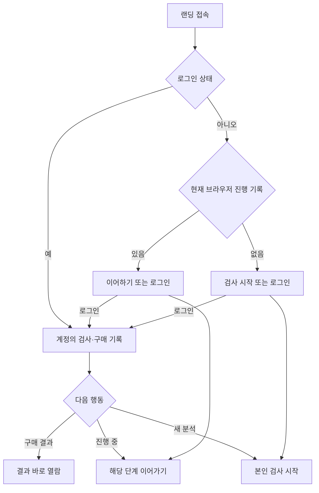
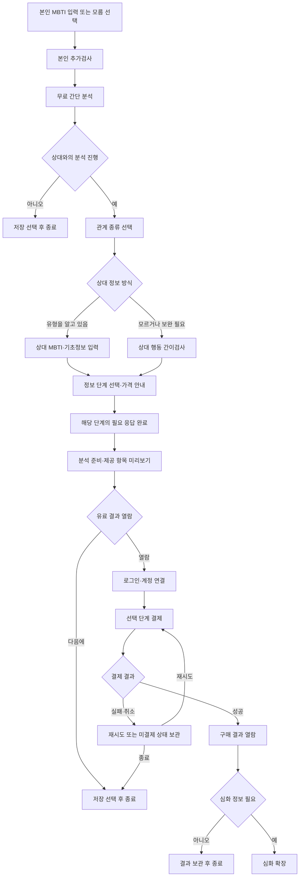
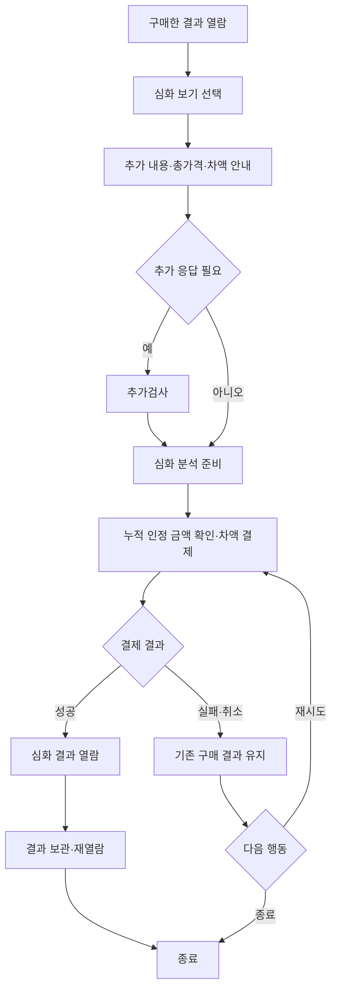

# 서비스 흐름

이 문서는 2026-10-07 사용자의 수정 요청과 그에 대한 후속 제안을 정리했다. 명시 요구사항은 확정으로, 나머지 상세 흐름은 제안으로 구별한다. 가격과 결제 위치는 아래 확정 원칙을 우선한다.

## 확정 원칙

1. 본인 검사 뒤 간단 분석을 제공한다.
2. 원하는 상대 정보를 입력하거나 상대 관련 간이검사를 진행한다.
3. 유료 결과는 검사·입력이 끝난 뒤, 결제 후 열람한다.
4. 정보 단계별 가격 범위는 4,900~9,900원이다.
5. 결과 열람 뒤 심화 정보를 원하면 앞서 결제한 비용을 제외한 금액을 추가 결제한다.

아래에서는 본인의 간단 분석을 무료로 제공하는 흐름으로 정리한다. 세부 제공 항목·단계 수·상품 이름·중간 가격은 아직 미정이다.

## 랜딩과 기존 기록 확인 — 제안

| 접속 상태 | 안내 | 주의할 구별 |
|---|---|---|
| 로그인 유지 | 내 결과·진행 중 검사·새 분석 | 계정 기록으로 이동 |
| 로그아웃, 현재 브라우저 진행 기록 있음 | 이어하기·기존 계정 로그인 | 브라우저 기록은 계정 본인 확인을 대신하지 않음 |
| 로그아웃, 현재 브라우저 기록 없음 | 검사 시작·기존 이용자 로그인 | 다른 기기 이용자를 신규라고 단정하지 않음 |

본인 검사는 비회원으로 시작하고 결제 직전 계정을 연결하는 안이다. 이메일 인증·간편로그인, 제공자, 비회원 보관 기간, 기기 변경 시 복구 방식은 미정이다. 비회원 응답은 로그인 후 해당 계정에 이어 붙여 다시 묻지 않는 방향을 검토한다.

## 본인 검사부터 유료 결과까지 — 흐름 제안

랜딩과 상대 분석 시작 화면에서 가격 범위를 미리 안내하고, 선택한 상품의 정확한 가격을 검사가 끝나기 전에 알리는 안이다. 미리보기에는 제공 항목·분석 범위를 명확히 보여주되 유료 상세 본문을 전부 공개하지 않는다.

`분석 준비`는 사용자가 필요한 입력을 완료했다는 상태다. 구현 시 유료 본문을 언제 생성·보관할지와 결제 전 노출 제어는 별도 기술 설계가 필요하다.

## 정보 출처별 분석 범위

| 출처 | 결과에서 구별할 표현 |
|---|---|
| 본인 응답 | 본인이 보고한 관계 패턴 |
| 사용자가 입력한 상대 MBTI | 입력 유형을 전제로 한 탐색적 비교 |
| 사용자의 상대 관찰 문항 | 사용자가 경험한 상대 행동 |
| 상대 직접 응답 | 상대가 보고한 자기 특성 |
| 양측의 같은 관계·사건 평가 | 인식 차이와 조정 과정에 대한 비교 |

상대 직접 초대·공유는 후보 기능이다. 위의 핵심 구매 흐름에 필수 기능으로 확정한 것은 아니다. 양측 프로필만으로 실제 상호작용을 측정했다고 표현하지 않는다.

## 심화 확장과 차액

| 예시 | 결제액 |
|---|---:|
| 최초 4,900원 단계 선택 | 4,900원 |
| 최초 9,900원 단계 선택 | 9,900원 |
| 4,900원 구매 후 9,900원 단계로 확장 | 추가 5,000원 |

위 표는 범위 내 양 끝 가격을 이용한 계산 예시다. 상품이 정확히 두 단계라는 결정은 아니다.

다단계 확장 시 계산 제안: `추가 결제액 = 상위 단계 가격 − 해당 분석에 인정되는 누적 결제액`. 같은 본인·상대·분석 건에 적용하는 범위안, 할인·환불·다른 상대·새 시점 재분석의 처리 방식은 미정이다. 인정 금액이 상위 가격 이상일 때의 처리도 실제 가격 정책과 함께 정한다.

추가검사에 앞서 차액을 안내한다. 심화 결제를 취소해도 기존 구매 결과는 유지하고 추가 응답을 저장할지 선택하게 하는 안이다.

## 재방문·예외·종료 — 제안

| 상태 | 재개 화면 또는 처리 |
|---|---|
| 본인 검사 중 | 마지막 응답 지점 |
| 무료 결과까지 완료 | 상대 입력 또는 무료 결과 |
| 상대 분석 준비·미결제 | 결제 안내 |
| 기본 결과 구매 | 재열람 또는 차액 심화 안내 |
| 심화검사 완료·미결제 | 차액 결제 안내 |
| 최상위 구매 완료 | 구매 결과 |
| 결제 성공 후 창 종료·생성 오류 | 결제 상태 확인 후 기존 구매 복구; 중복 결제 방지 |
| 결제 여부 확인 중 | 확인 중 상태 표시; 확인 전 구매 완료·미결제를 단정하지 않음 |
| 생성 실패 지속 | 재처리·문의·환불 기준에 따른 처리; 세부 정책 미정 |

검사 중단, 결과 열람 후 종료, 공유 해제·기록 삭제는 서로 다른 상태다. 단순 창 종료를 탈퇴·연구 참여 철회로 처리하지 않는다. 저장·재열람 기간, 알림 전송, 공유 해제 시 양측에 미치는 범위는 아직 정해야 한다.

## 미정 정책

상품 단계와 정보 목록, 로그인·인증 제공자, 비회원 저장 기간, 차액 인정 범위, 구매 후 상대 정보 수정, 환불·할인, 재분석, 공유·삭제, 결제 제공자와 오류 복구 기준을 후속 논의에서 정한다.
