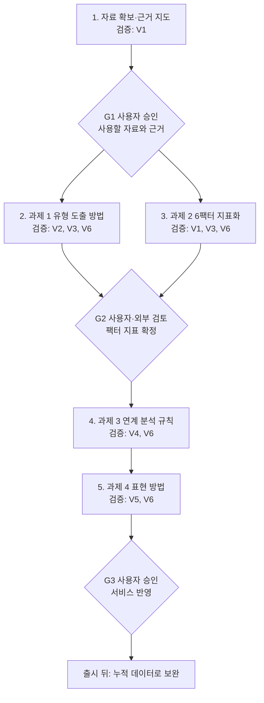

# 연구 재개 논의 정리와 연구 로드맵

작성일: 2026-10-16 · 갱신: 2026-10-19(AI 에이전트 수행 D-014, 기존 자료 활용으로 전면 수정 D-015)

상태: **연구 재개(D-009).** 아래의 사용자 결정(D-009~D-015)은 확정이며, 과제별 방법·계수·기준·활용 자료는 원문과 이용 조건 확인 전의 **제안**이다. 2026-10-16~19에 제안했던 표본조사 중심 로드맵(기준 조사·독립 검증·커플 조사)은 D-015로 대체되었다.

관련 문서: [결정 기록](../decisions/decision-log.md) · [모델 가설](model-hypotheses.md) · [이전 연구 방법 제안](research-plan.md) · [연구 종합 인수인계](../handoff/research-briefing.md)

## 1. 이번 논의에서 정해진 것

| ID | 사용자 결정 | 의미 |
|---|---|---|
| D-009 | 서비스 논의는 뒤로 미루고 연구 내용 검증과 데이터 분석·연구를 먼저 시작한다. | D-007(연구 보류)을 대체 |
| D-010 | 연인과 부부는 분리해서 본다. | 관계 성격이 다르고 연인에는 미성년자도 있기 때문 |
| D-011 | 서비스는 상담·심화 검사로 개인을 정밀 분석하는 서비스가 아니라, 사용자 입력과 약식 검사로 도출한 유형에 기반해 정보를 제공하는 서비스로 본다. | D-001의 "MBTI는 보조 정보" 해석을 바꿈. 6팩터는 유형 정보를 설명·세분화하는 틀 |
| D-012 | 약식 검사로 1~3순위 MBTI 유형을 도출하고, 6팩터 지표는 1순위 유형을 기본값으로 삼아 2~3순위 유형으로 보정한다. 가중합이 아니다. | 연구 결과물 1·2 |
| D-013 | 상대 유형과의 비교·적합 가이드는 기계적·공식적 판정(예: "F는 공감이 필요한데 T는 이성적이라 보완이 안 된다")을 하지 않는다. | 연구 결과물 3의 작성 원칙 |
| D-014 | 연구 수행은 AI 에이전트가 하며, 여러 에이전트가 교차 검증·평가하는 구간을 둔다(2026-10-19). | 아래 5장 |
| D-015 | 신규 표본조사는 지금 하지 않는다. 연구는 기존 데이터와 연구 결과를 활용·가공하며, 표본 자료 수집·분석은 서비스 출시 뒤 누적 데이터로 보완한다. 과제는 (1) 1~3순위 유형 도출 방법 (2) 6팩터 지표화 방법 (3) 지표와 유형의 연계 분석 방법 (4) 설득력 있는 표현 방법이다(2026-10-19). | 이전 조사 설계 대체 |

## 2. 연구 과제와 목표 결과물

| 과제 | 핵심 질문 | 주요 산출물 |
|---|---|---|
| 1. 1~3순위 유형 도출 | 입력 유형과 약식 검사로 차원별 뚜렷함과 2·3순위를 어떻게 정하나 | 약식 검사 문항안, 차원 점수·확신도·순위 산출 명세, 입력 유형 확인 규칙 |
| 2. 6팩터 지표화 | 유형과 차원 점수로 6팩터를 어떻게 지표화하나(1순위 기본값 + 2·3순위 보정, D-012) | 근거 상관표, 유형별 기대 프로필(16×6), 보정 계수, 팩터별 근거 등급 |
| 3. 지표·유형 연계 분석 | 내 지표와 상대 유형(또는 제안 유형)을 어떻게 비교하나 | 조합 규칙표(조건·근거·등급), 상황 시나리오, 유형 제안 규칙 |
| 4. 설득력 있는 표현 | 결과를 납득하고 행동으로 옮길 수 있게 어떻게 쓰나 | 표현 가이드, 문장 템플릿, 금지 표현 목록, 예시 결과 문구 |

예: 1~3순위가 ENFP-INFP-INFJ라면 E–I가 가장 경계에 가깝고 그다음이 J–P라는 정보다. 6팩터 지표는 ENFP 기대 프로필을 기본으로 E–I·J–P 차원 점수만큼 보정한다. 상대가 ISFJ로 입력되면 ISFJ 기대 프로필과 비교한 가이드를, 입력이 없으면 성격이 다른 몇 가지 유형을 설명한다.

### 조합 가이드 작성 원칙 — 제안

1. 상황을 조건으로 단다. "갈등 직후에는", "중요한 결정을 할 때는"처럼 언제 그런지 밝힌다.
2. 양방향으로 쓴다. 서로 주는 것과 부담이 될 수 있는 것을 함께 쓴다.
3. 여러 팩터를 함께 본다. 한 축의 차이로 결론을 내지 않는다.
4. 표현 방식의 차이를 번역한다. 예: 해결 제안도 관심의 표현일 수 있음을 알리고 필요한 반응을 요청하는 방법을 제안한다.
5. 구체적 행동으로 끝난다. "잘 맞는다/안 맞는다" 대신 다음 대화에서 해볼 것을 제시한다.
6. 가능성으로 말한다. 유형 정보의 한계를 문장에 담는다.

## 3. 분석에서 확인된 주요 판단 — 제안·가설

- **유지할 자산**: 분석 수준 분리, 애착불안·회피 분리, SDT 자율성과 독립성 구분, 정서반응성과 조절 분리, 자료 출처 보존, 순환 검증 금지.
- **유형 간 차이가 작을 수 있는 팩터**: MBTI 네 차원은 Big Five 중 외향성·개방성·우호성·성실성과 관련되고 정서적 불안정성 축은 없다(McCrae & Costa, 1989). Agency·Communion은 유형과 어느 정도 연결되겠지만 애착·정서조절은 유형 간 평균 차이가 작을 것으로 예상한다(검증 전 가설). 이 경우 해당 팩터의 유형 기반 보정과 가이드도 유형과 무관하게 비슷해지므로, 1차 자료에서 유형 간 차이가 의미 있게 나온 팩터만 유형 기반 지표로 쓰는 규칙을 미리 정한다.
- **조합 효과의 크기**: 부부 대규모 표본에서 성격 유사성은 관계만족 분산의 0.5% 미만을 설명했다(Dyrenforth et al., 2010). 43개 커플 종단연구 분석에서는 관계별 지각 변수가 개인차 변수보다 관계 질을 더 많이 설명했다(Joel et al., 2020). 조합 가이드는 "궁합 판정"이 아니라 설명·대화 도구로 설계하는 근거다.
- **입력 MBTI의 출처**: 한국 사용자가 아는 유형 중 상당수가 공식 검사가 아닌 무료 온라인 검사 결과일 가능성이 있다(추정). 출처를 "공식 검사 / 16Personalities / 기타 / 모름"으로 기록한다.

## 4. 과제별 방법 — 제안

### 활용할 기존 자료 — 후보, 원문·이용 조건 확인 전

| 자료 | 쓰이는 과제 | 확인할 것 |
|---|---|---|
| MBTI 차원–Big Five 상관 연구(McCrae & Costa, 1989 등) | 1, 2 | 원문 수치, 후속 연구 일치 |
| Big Five–애착·정서조절·관계만족 메타분석(Malouff et al., 2010 등) | 2, 3 | 수치·표본, 서지 원문 |
| 대인관계 원형(IPC) 연구, 상보성 원리 | 2, 3 | 상관 수치, 상보성 증거 일관성 |
| 공개 원자료(예: Open-Source Psychometrics Project의 OEJTS, IPIP Big Five, ECR 응답 자료) | 1, 2 | 현재 공개 여부, 상업 이용 조건, 표본 특성 |
| 공개 문항 풀(IPIP) | 1 | 한국어 번역본, 문항 근거 |
| 커플 연구(Joel et al., 2020; Dyrenforth et al., 2010) | 3, 4 | 확인 완료 |
| 갈등 상호작용 연구(요구–철수, 애착 조합) | 3 | 기억 기반, 원문 확인 필요 |

같은 사람이 MBTI형 척도와 6팩터 척도에 함께 응답한 공개 자료는 없을 가능성이 크다(추정). 그래서 Big Five를 다리로 연결한다.

### 과제 1: 1~3순위 유형 도출

1. 공식 MBTI 문항은 저작권 때문에 쓰지 않고, 공개 문항(IPIP, 조건이 맞으면 OEJTS)에서 차원별 문항을 골라 한국어로 옮긴다.
2. 차원별로 경계(0) 중심 연속 점수를 만들고, 기준값은 공개 원자료에서 구한 뒤 출시 뒤 한국 자료로 교체한다.
3. 문항 수와 신뢰도로 측정오차를 계산해 차원별 확신도(현재 방향이 맞을 가능성)를 구한다.
4. 1순위는 각 차원의 방향, 2·3순위는 확신도가 낮은 차원을 뒤집은 유형 중 가능성이 높은 순서다.
5. 입력 유형과 다른 차원은 확신도에 따라 "검사로는 I 쪽이 뚜렷함" 또는 "E와 I 모두 가능"으로 안내한다. 입력 출처(공식 검사/16Personalities/기타/모름)를 받는다.

### 과제 2: 6팩터 지표화

1. 팩터 정의서로 포함·제외 범위를 정한다(애착불안·회피, SDT 자율성과 독립성, 정서반응성과 조절 구분).
2. 문헌·메타분석의 "MBTI 4차원 ↔ Big Five ↔ 6팩터" 상관을 하나의 근거 상관표로 모은다(칸마다 출처·표본 크기).
3. 메타분석 상관 기반 구조방정식(MASEM)으로 팩터를 4차원 점수에 회귀해 유형별 기대 프로필을 구한다.
4. 사용자 지표 = 1순위 유형 기대값 + Σ(차원 계수 × (내 차원 점수 − 1순위 유형 대표 점수)).
5. 팩터별 근거 등급(A 직접 근거, B Big Five 경유, C 연결 약함)을 매긴다. 애착불안·정서반응성은 신경증 성향과 주로 관련되어 C가 될 가능성이 크다(가설). C등급은 약식 검사 문항 추가 또는 -A/-T 입력 활용(추정, 확인 필요)을 검토한다.
6. 점수는 5단계 수준과 근거 등급으로 표시한다. 상관을 두 번 거쳐 유형 간 차이는 작게 나올 가능성이 크다.

### 과제 3: 지표·유형 연계 분석

1. 내 지표(확신도 포함)와 상대 유형 기대 프로필을 팩터별로 비교한다. 상대 입력·사용자 관찰·상대 자기보고는 출처를 구분한다.
2. 차이를 유사·상보 가능·마찰 가능 패턴으로 나누되, 문헌 근거가 있는 패턴만 규칙으로 만든다(예: IPC 상보성 원리, 애착불안–회피 조합의 요구–철수 패턴).
3. 두세 팩터의 조합을 상황(갈등 직후, 중요한 결정, 일상 친밀감, 각자의 시간)별 시나리오로 엮는다(D-013).
4. 상대 유형이 없으면 "최고 궁합" 대신 성격이 다른 몇 가지 예(편안함이 큰 유형, 서로 채워 줄 수 있는 유형, 성장 여지가 큰 유형)를 보여 준다.
5. 조합 효과가 작다는 연구(Dyrenforth et al., 2010)를 반영해 판정이 아니라 대화 주제와 행동 제안으로 쓴다.

### 과제 4: 설득력 있는 표현

1. 문장 구조: 근거 → 의미 → 상대·상황에서의 모습 → 다음 대화에서 해볼 것.
2. 결과의 근거를 보여 준다("E와 I의 경계에 가깝게 나와서"). 누구에게나 맞는 막연한 문장(바넘 효과)에 기대지 않는다.
3. 강점 먼저, 약점은 상황 조건과 보완 방법을 함께 쓴다.
4. 근거 등급·확신도에 따라 "뚜렷합니다/경향이 있습니다/그럴 수 있습니다"로 수위를 정한다.
5. 금지 표현: 궁합 점수, "안 맞는다", "운명", 성별·유형 고정관념, 한 축만의 결론.
6. ENFP-INFP-INFJ × ISFJ, 상대 미입력 사례로 예시 결과 문구 세트를 만든다.

### 출시 뒤 데이터로 보완

차원 기준값(한국 응답), 순위 안정성(재응답), 팩터 계수(팩터 문항 함께 응답), 조합 규칙(양측 응답 커플), 표현(평가·문구 비교)을 누적 데이터로 교체·수정한다. 개인정보 수집·이용 동의와 별도로 연구 목적 이용 선택 동의를 설계하고, 학술 발표 시점에 연구윤리 심의를 받는다.

## 5. AI 에이전트 수행과 교차 검증 — 제안

| 구간 | 대상 | 방식 |
|---|---|---|
| V1 문헌 | 인용·상관 수치 | 두 에이전트가 각자 원문과 대조, 미확인은 "미확인" 표시 |
| V2 문항 | 약식 검사 문항안 | 작성자가 아닌 에이전트들의 독립 평정 |
| V3 계산 | 점수·확신도·기대 프로필·보정 계수 | 두 에이전트의 독립 코딩 결과 일치 확인 |
| V4 규칙 | 조합 규칙표 | 규칙별 근거 문헌·등급 대조 |
| V5 표현 | 결과 문구 | 표현 원칙·금지 표현으로 채점 |
| V6 반대 검토 | 모든 결론 | 과대 해석, MBTI 단정, 기계적 판정(D-013) 검토 |

불일치는 세 번째 에이전트가 판정하고, 남으면 사용자에게 올린다. 같은 계열 모델은 같은 오류를 공유할 수 있어 관문마다 사용자 승인을 둔다. AI가 만든 가상 응답은 계산 점검에만 쓴다.

### 작업 순서와 관문

기간은 정하지 않았다. 원척도 전체 문항과 재배포가 허용되지 않는 원자료는 저장소에 올리지 않는다.

## 6. 아직 정하지 않은 것

- 공개 원자료가 비상업 조건일 때의 활용 범위(제안: 연구용 분석으로 방향만 확인, 서비스 계수는 논문 수치와 출시 뒤 자료로 산출).
- 약식 검사 문항 출처(제안: IPIP 기반 자체 구성).
- C등급 팩터 처리(제안: 문항 몇 개 추가).
- 부부 규칙 분리 시점(제안: 연인 규칙 다음).
- 관문 승인자(제안: G2는 외부 전문가 검토 포함).
- "MBTI" 명칭 사용의 법률 확인(서비스 논의 때).
- 서비스 문서의 D-011 반영(서비스 논의 재개 때).

## 6. 근거 자료

- Joel, S., et al. (2020). Machine learning uncovers the most robust self-report predictors of relationship quality across 43 longitudinal couples studies. *PNAS*. [원문](https://socialinteractionlab.psych.umn.edu/sites/socialinteractionlab.psych.umn.edu/files/2020-12/joel_et_al._pnas_2020.pdf) — 11,196쌍; 관계별 지각 변수가 기준시점 관계 질의 최대 45%, 개인차 변수가 최대 21% 설명. 2026-10-16 원문 확인.
- Dyrenforth, P. S., Kashy, D. A., Donnellan, M. B., & Lucas, R. E. (2010). *JPSP*, 99(4), 690–702. [초록](https://www.iser.essex.ac.uk/research/publications/513887) — 본인 성격 약 6%, 상대 1~3%, 유사성 0.5% 미만(관계만족). 2026-10-16 초록 확인.
- McCrae & Costa (1989) 등 기존 자료는 [참고자료](references.md) 참조. 애착 완충 효과(Simpson·Rholes 계열), 한국판 ECR-R 등은 원문 확인 전 기억 기반 서지다.
