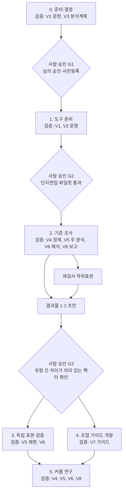

# 연구 재개 논의 정리와 연구 로드맵

작성일: 2026-10-16 · 갱신: 2026-10-19(AI 에이전트 수행 반영)

상태: **연구 재개(D-009).** 아래의 사용자 결정(D-009~D-014)은 확정이며, 로드맵의 단계·표본 규모·측정 도구는 검정력 분석과 연구윤리 심의 전의 **제안**이다.

관련 문서: [결정 기록](../decisions/decision-log.md) · [모델 가설](model-hypotheses.md) · [이전 연구 방법 제안](research-plan.md) · [연구 종합 인수인계](../handoff/research-briefing.md)

## 1. 이번 논의에서 정해진 것

| ID | 사용자 결정 | 의미 |
|---|---|---|
| D-009 | 서비스 논의는 뒤로 미루고 연구 내용 검증과 데이터 분석·연구를 먼저 시작한다. | D-007(연구 보류)을 대체 |
| D-010 | 연인과 부부는 분리해서 본다. | 관계 성격이 다르고 연인에는 미성년자도 있기 때문 |
| D-011 | 서비스는 상담·심화 검사로 개인을 정밀 분석하는 서비스가 아니라, 사용자 입력과 약식 검사로 도출한 유형에 기반해 정보를 제공하는 서비스로 본다. | D-001의 "MBTI는 보조 정보" 해석을 바꿈. 6팩터는 유형 정보를 설명·세분화하는 틀 |
| D-012 | 약식 검사로 1~3순위 MBTI 유형을 도출하고, 6팩터 지표는 1순위 유형을 기본값으로 삼아 2~3순위 유형으로 보정한다. 가중합이 아니다. | 연구 결과물 1·2 |
| D-013 | 상대 유형과의 비교·적합 가이드는 기계적·공식적 판정(예: "F는 공감이 필요한데 T는 이성적이라 보완이 안 된다")을 하지 않는다. | 연구 결과물 3의 작성 원칙 |
| D-014 | 연구 수행은 AI 에이전트가 하며, 여러 에이전트가 교차 검증·평가하는 구간을 둔다(2026-10-19). | 아래 4장 "AI 에이전트 수행과 교차 검증" |

## 2. 목표 연구 결과물

| 결과물 | 내용 | 연구로 구체화할 것 |
|---|---|---|
| 1. 1~3순위 유형 | 입력 MBTI와 약식 검사로 각 차원(E–I 등)이 뚜렷한지 경계에 가까운지 파악하고, 연관 유형까지 1~3순위로 지표화. 입력 MBTI 검증 기능 포함 | 차원별 연속 점수, 경계 근접도 지표, 순위 산출 규칙, 측정오차 범위, 입력 유형과의 불일치 패턴 |
| 2. 6팩터 지표 | 1순위 유형의 6팩터 프로필을 기본값으로, 2·3순위 유형으로 보정 | 유형별 6팩터 평균·범위, 차원별 보정량(뒤집힌 차원이 각 팩터에 주는 차이 × 경계 근접도) |
| 3. 조합 가이드 | 사용자의 강점·약점과 상대 유형(입력 시) 또는 추천 유형들과의 시너지·보완을 설명 | 팩터 단위 문헌 근거, 가이드 작성 원칙, 사용자 이해도·유용성 평가 |

예: 1~3순위가 ENFP-INFP-INFJ라면 E–I가 가장 경계에 가깝고 그다음이 J–P라는 정보다. 6팩터 지표는 ENFP 프로필을 기본으로 E–I·J–P 차원의 보정을 더한다. 상대가 ISFJ로 입력되면 ISFJ 프로필과 비교한 가이드를, 입력이 없으면 사용자 지표에 맞춰 몇 가지 유형을 설명한다.

### 조합 가이드 작성 원칙 — 제안

1. 상황을 조건으로 단다. "갈등 직후에는", "중요한 결정을 할 때는"처럼 언제 그런지 밝힌다.
2. 양방향으로 쓴다. 서로 주는 것과 부담이 될 수 있는 것을 함께 쓴다.
3. 여러 팩터를 함께 본다. 한 축의 차이로 결론을 내지 않는다.
4. 표현 방식의 차이를 번역한다. 예: 해결 제안도 관심의 표현일 수 있음을 알리고 필요한 반응을 요청하는 방법을 제안한다.
5. 구체적 행동으로 끝난다. "잘 맞는다/안 맞는다" 대신 다음 대화에서 해볼 것을 제시한다.
6. 가능성으로 말한다. 유형 정보의 한계를 문장에 담는다.

## 3. 분석에서 확인된 주요 판단 — 제안·가설

- **유지할 자산**: 분석 수준 분리, 애착불안·회피 분리, SDT 자율성과 독립성 구분, 정서반응성과 조절 분리, 자료 출처 보존, 순환 검증 금지.
- **유형 간 차이가 작을 수 있는 팩터**: MBTI 네 차원은 Big Five 중 외향성·개방성·우호성·성실성과 관련되고 정서적 불안정성 축은 없다(McCrae & Costa, 1989). Agency·Communion은 유형과 어느 정도 연결되겠지만 애착·정서조절은 유형 간 평균 차이가 작을 것으로 예상한다(검증 전 가설). 이 경우 해당 팩터의 유형 기반 보정과 가이드도 유형과 무관하게 비슷해지므로, 1차 자료에서 유형 간 차이가 의미 있게 나온 팩터만 유형 기반 지표로 쓰는 규칙을 미리 정한다.
- **조합 효과의 크기**: 부부 대규모 표본에서 성격 유사성은 관계만족 분산의 0.5% 미만을 설명했다(Dyrenforth et al., 2010). 43개 커플 종단연구 분석에서는 관계별 지각 변수가 개인차 변수보다 관계 질을 더 많이 설명했다(Joel et al., 2020). 조합 가이드는 "궁합 판정"이 아니라 설명·대화 도구로 설계하는 근거다.
- **입력 MBTI의 출처**: 한국 사용자가 아는 유형 중 상당수가 공식 검사가 아닌 무료 온라인 검사 결과일 가능성이 있다(추정). 출처를 "공식 검사 / 16Personalities / 기타 / 모름"으로 기록한다.
- **팩터별 측정**: 애착은 기존 척도(ECR-R·ECR-RS 등) 채택을 우선하고, Coordination은 1차에서 기존 도구(DCI·CPQ 등)로 대리 측정하는 안.

## 4. 연구 로드맵 — 제안

기간 예시: 0단계 1~2개월, 1단계 2~3개월, 2단계 2~3개월, 3·4단계 병행 3~4개월, 5단계 4~6개월(후속 측정 포함). 에이전트는 문헌·분석·작성 시간을 줄이지만 심의·모집·응답 기간은 줄이지 못한다.

### AI 에이전트 수행과 교차 검증 — 제안

**사람이 맡는 일.** 연구윤리 심의 제도는 사람인 연구책임자가 신청하고 책임지는 구조이므로, 다음은 에이전트가 초안을 만들더라도 사람이 결정한다: 연구책임자 지정과 심의 신청, 참가자 모집·동의·보상·문의 대응, 원자료(식별 정보 포함) 보관과 비식별 자료 반출, 척도 사용 허락과 패널 계약, 관문 G1~G3 최종 승인, 학술 발표·공개 결정.

**에이전트 역할.**

| 역할 | 하는 일 | 하지 않는 일 |
|---|---|---|
| 문헌 | 팩터별 문헌·척도 조사, 인용 원문 대조, 근거표 | 원문 미확인 주장을 확인된 근거로 쓰기 |
| 문항 | 약식 검사 문항·번역 초안, 인지면접 질문지 | 원척도 전체 문항을 저장소에 커밋 |
| 설계 | 사전등록 초안, 검정력 시뮬레이션, 조사지 흐름 | 참가자와 직접 연락 |
| 분석(2개 이상) | 같은 분석계획으로 서로 독립적으로 코딩·분석 | 다른 분석 에이전트의 결과를 미리 보기 |
| 가이드 | 조합 가이드 규칙표와 문장 | 근거표에 없는 조합 주장 |
| 검토 | 과대 해석, MBTI 단정, 기계적 표현(D-013), 수치 오류를 찾는 반대 입장 검토 | 자기 결과물 검토 |
| 기록 | 작업 로그, 버전, 불일치 기록, 관문 보고서 | AI 제안을 사용자 결정으로 기록 |

**교차 검증 구간.**

| 구간 | 대상 | 방식 | 통과 기준(제안) |
|---|---|---|---|
| V1 문헌 | 인용·수치 | 두 에이전트가 각자 원문과 대조 | 미확인 인용은 "미확인" 표시, 수치 불일치 0건 |
| V2 문항 | 약식 검사·단축 문항 | 작성자 외 2개 이상 에이전트의 독립 평정(구성개념 적합, 이중질문, 난이도) | 평정 일치도 기준 충족 문항만 인지면접으로 |
| V3 분석계획 | 사전등록 분석 코드 | 가상 자료로 두 분석 에이전트가 독립 코딩 | 추정치가 허용오차 안에서 일치 |
| V4 자료 정제 | 부주의 응답 제외, 결측 처리 | 사전등록 규칙을 각자 적용 | 제외 목록 완전 일치 |
| V5 주 분석 | 결과물 1·2 추정치와 판정 | 서로 결과를 보지 않고 재현 | 핵심 추정치 일치, 팩터 채택 판정 동일 |
| V6 해석 | 결론 문장 | 검토 에이전트의 반대 입장 검토 | 지적 사항 모두 처리 |
| V7 가이드 | 조합 가이드 문장 | 작성 원칙 6개로 다른 에이전트가 채점, 일부는 사람 전문가 표본 검토 | 원칙 위반 0건, 전문가 검토 통과 |
| V8 보고 | 보고서 표·수치 | 분석 결과 파일과 자동 대조 | 불일치 0건 |

불일치가 나오면 세 번째 에이전트가 원인을 판정하고, 그래도 남으면 사람 판단으로 올린다. 모든 불일치와 처리 결과는 기록한다.

**운영 규칙.** 교차 검증 에이전트끼리는 결과를 공유하지 않고 같은 입력만 받으며, 가능하면 서로 다른 모델이나 지시문을 쓴다. AI가 만든 응답은 분석 코드 점검용 가상 자료로만 쓰고 실제 참가자 자료나 연구 결과로 쓰지 않는다. 에이전트에게는 비식별 자료만 주고, 연락처·동의서·보상 정보는 사람이 관리하는 별도 저장소에 둔다. 사전등록 뒤 분석을 바꾸면 이유와 함께 탐색적 분석으로 표시한다.

**한계.** 같은 계열 모델끼리는 같은 오류를 공유할 수 있어 관문마다 사람 승인을 둔다. 문헌 인용은 존재하지 않는 서지나 틀린 수치가 생길 위험이 있어 V1을 모든 단계에 적용한다.

### 0단계: 준비·결정

- 대상 집단: 성인 연인, 부부를 별도 집단으로 둔다(D-010). 미성년 연인은 법정대리인 동의 등 절차가 추가로 필요해 성인 연구 뒤로 미루는 안. 팀(직장)도 별도 집단.
- 1차 결과변수: 관계만족과 갈등 부담(제안).
- 연구책임자·공동연구자, 연구윤리 심의 경로(대학 공동연구 또는 공용기관생명윤리위원회), 척도 사용 허락 확인.
- 가설·분석계획·팩터 채택 기준을 사전등록.

관문: 심의 승인과 사전등록 완료.

### 1단계: 도구 준비

- MBTI 네 차원 약식 검사 문항 초안 작성. 차원별 연속 점수를 낼 수 있게 설계하고, 공개 문항(IPIP 계열) 활용 가능성을 검토한다.
- 6팩터 측정 도구 확정: 기존 척도 우선, 한국어판 근거와 사용 조건 확인.
- 통제·비교 변수: Big Five 단축형, 관계 지각 변수(지각된 상대 반응성·헌신 등), 입력 MBTI와 그 출처.
- 인지면접(예: 20~30명)과 운영 파일럿(예: 80~120명)으로 이해도·응답 부담·이탈을 점검.

관문: 문항 이해도와 응답 시간이 기준을 충족.

### 2단계: 기준 조사 (성인 연인 1차, 부부 별도)

- 같은 사람에게 입력 MBTI(출처 포함), 약식 검사, 6팩터, Big Five, 관계 지각, 관계 결과를 측정한다.
- 유형별 프로필을 만들려면 유형마다 일정 인원이 필요하다. 입력 유형 기준 할당 표본(예: 유형당 최소 30~50명, 전체 약 800~1,200명)을 검토하되, 최종 규모는 검정력 분석으로 정한다. 드문 유형은 표본 확보가 어렵다.
- 일부 표본(예: 150~200명)은 2~4주 뒤 재검사해 경계 근처 점수의 측정오차를 구한다.
- 산출: 결과물 1의 순위 규칙 초안, 결과물 2의 유형별 프로필과 차원별 보정량, 팩터별 유형 간 차이 크기.

관문: 유형 간 차이가 의미 있는 팩터와 그렇지 않은 팩터를 구분하고, 지표에 쓸 범위를 사전등록 기준에 따라 확정.

### 3단계: 독립 표본 검증

- 새 표본에서 1~3순위의 재현성, 유형별 프로필과 보정 규칙의 재현성을 확인한다.
- 서비스용 짧은 6팩터 문항을 개발해 기준 척도에 맞춰 보정한다(필요 시).

### 4단계: 조합 가이드 개발 (3단계와 병행 가능)

- 팩터 단위 문헌 근거로 가이드 규칙을 만들고, 위 작성 원칙으로 문장을 작성한다.
- 상담·관계 전문가 검토와 사용자 평가(이해도·유용성·불쾌감)를 받는다. 이 평가는 사용성 자료이며 예측 정확도 근거가 아니다.

### 5단계: 커플 연구

- 양측이 응답한 커플 표본으로 가이드가 가정한 조합 효과를 검증하고, 일정 기간 뒤 후속 측정을 한다.
- 조합·유사성 효과는 작을 가능성이 커서 큰 표본이 필요하다. 검정력 분석으로 규모를 정한다.

## 5. 아직 정하지 않은 것

- 사람 연구책임자와 심의 경로, 예산, 조사 패널 선정.
- 에이전트 구성(같은 모델 여러 역할 또는 서로 다른 모델 혼합)과 관문 승인자(외부 전문가 포함 여부).
- 1차 결과변수 최종 확정.
- 약식 검사 문항 수와 응답 시간 목표.
- 1~3순위 산출 규칙과 경계 판정 기준(재검사 자료 이후).
- 팩터별 측정 도구 최종 선정과 사용권.
- 서비스 문서(서비스 개요 등)의 D-011 반영: 서비스 논의를 재개할 때 함께 갱신.

## 6. 근거 자료

- Joel, S., et al. (2020). Machine learning uncovers the most robust self-report predictors of relationship quality across 43 longitudinal couples studies. *PNAS*. [원문](https://socialinteractionlab.psych.umn.edu/sites/socialinteractionlab.psych.umn.edu/files/2020-12/joel_et_al._pnas_2020.pdf) — 11,196쌍; 관계별 지각 변수가 기준시점 관계 질의 최대 45%, 개인차 변수가 최대 21% 설명. 2026-10-16 원문 확인.
- Dyrenforth, P. S., Kashy, D. A., Donnellan, M. B., & Lucas, R. E. (2010). *JPSP*, 99(4), 690–702. [초록](https://www.iser.essex.ac.uk/research/publications/513887) — 본인 성격 약 6%, 상대 1~3%, 유사성 0.5% 미만(관계만족). 2026-10-16 초록 확인.
- McCrae & Costa (1989) 등 기존 자료는 [참고자료](references.md) 참조. 애착 완충 효과(Simpson·Rholes 계열), 한국판 ECR-R 등은 원문 확인 전 기억 기반 서지다.
